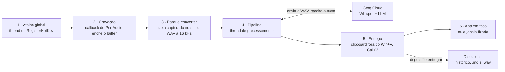

# Willy · Visão geral e funcionalidades

Atualizado em 23/11/2026 · base: `main` com o Willy 1.14.5 · cada afirmação foi conferida no código, e os números de comportamento (exemplos de saída, tamanhos, contagens) foram medidos.

## Visão geral

O Willy é um assistente de voz para Windows: você aperta um atalho, fala, e o texto transcrito e revisado por IA é colado no cursor de qualquer programa. Ele também traduz para inglês, transforma texto selecionado, gera prompts de agente e grava reuniões com ata executiva.

A transcrição usa o Whisper hospedado na Groq (`whisper-large-v3-turbo` por padrão), e o refino usa um LLM da Groq (`openai/gpt-oss-120b` por padrão). O app roda localmente em Python 3.12, com interface em CustomTkinter e integração direta com a API Win32.

| Indicador | Valor em 23/11/2026 |
| --- | --- |
| Código do produto | 24.050 linhas em 66 arquivos (`core/`, `ui/`, `willy.py`, `versao.py`) |
| Testes | 1.900 testes em 134 arquivos `test_*.py`, 32.718 linhas (`python -m unittest discover -s tests`) |
| Histórico | 330 commits desde 17/09/2026 e 28 PRs no repositório privado antes da abertura na 1.14.1. Os números de PR citados nas versões anteriores são de lá. O repositório público começa na 1.14.1 com 1 commit e numera os PRs dele a partir do #1 |
| Versão | 1.14.5, definida só em `versao.py` |
| Plataforma | Windows 10/11, executável via PyInstaller + instalador Inno Setup |

A versão tem uma fonte única, `versao.py`. A tela "Sobre", o perfil exportado e o instalador leem dali, e `tests/test_versao.py` reprova qualquer número de versão escrito à mão em outro lugar. Até 08/10 havia quatro números ao mesmo tempo (1.2.0, 1.3.0, 1.4.0 e 1.9.0); ficou o 1.4.0, que era o mostrado na tela "Sobre".

## Arquitetura

O Willy é um único processo Python com quatro threads principais: a dos atalhos, a do callback de áudio, a de processamento e a da interface. Um ditado passa pelas três primeiras; a interface só acompanha.

A pílula, o dashboard e a bandeja ficam fora desse caminho: recebem cada mudança de estado por uma fila que a thread principal drena a cada 16 ms.

| Camada | Módulos | Responsabilidade |
| --- | --- | --- |
| Orquestração | `willy.py` | Liga atalhos, áudio, pipeline e interface; início e encerramento |
| Atalhos | `core/hotkey.py`, `core/system/hotkey_orchestrator.py` | Registro Win32 e recarga dos 14 atalhos |
| Áudio | `core/audio.py`, `core/audio_processing/` | Captura, detecção de fala, mixagem, 16 kHz, fatiamento |
| Pipeline | `core/pipeline/transcription_pipeline.py` | Etapas de cada modo e classificação de erros |
| IA | `core/groq_service.py`, `core/actions.py`, `core/context.py` | Chamadas à Groq, copiloto de ações, contexto do app e do Git |
| Texto | `core/text_processing.py`, `core/snippets.py` | Comandos de voz, muletas, identificadores, snippets |
| Entrega | `core/system/injector.py` | Clipboard seguro, Ctrl+V, restauração |
| Dados | `core/config.py`, `core/storage/` | `.env`, histórico, vocabulário, substituições, perfis |
| Sistema | `core/single_instance.py`, `core/autostart.py`, `core/sound.py`, `core/tts.py` | Instância única, inicialização com o Windows, bipes, voz |
| Interface | `ui/dashboard.py`, `ui/tabs/`, `ui/overlays/`, `ui/components/`, `ui/theme.py` | Janela, abas, pílula, Spotlight, legendas, bandeja, tokens |

`core/` não importa nada de `ui/`: a interface depende do núcleo, nunca o contrário, e `tests/test_estrutura.py` reprova o caminho inverso. Na raiz ficam só os pontos de entrada: `willy.py` (o app), `versao.py` (a versão) e `build_installer.py` (o build).

## Atalhos globais e modos de uso

O Willy registra 14 atalhos globais pelo Win32 (`RegisterHotKey` com `MOD_NOREPEAT`, debounce de 0,35 s), todos editáveis. Seis deles iniciam uma gravação; os outros agem sobre texto, janelas ou o próprio app. Combinação que o Windows não registra (outro programa ou outro atalho do Willy já usa) vira aviso na pílula e na bandeja, e na linha do atalho na aba Atalhos ("⚠️ Em uso por outro programa no Windows — clique no atalho ao lado para trocar"; com dois atalhos do Willy na mesma combinação, "Mesma combinação de …"); numa troca recusada, a combinação anterior continua valendo, fica salva no `.env` e é a que as abas Atalhos e Ajustes mostram. Na partida, as legendas no padrão Ctrl+Alt+L recusado pelo Windows passam ao Ctrl+Alt+J, que vai para o `.env`, sem aviso (no willy_debug.log do dono, o Ctrl+Alt+L era recusado em todas as partidas desde 08/10); se o Ctrl+Alt+J também estiver tomado, ou outro atalho do Willy o usar, fica o aviso de sempre. Uma combinação escolhida pela pessoa que falha não muda.

| Ação | Padrão | O que faz |
| --- | --- | --- |
| Ditado | Ctrl+Espaço | Grava, transcreve, refina e cola no cursor; segunda pressão encerra |
| Tradução para inglês | Ctrl+Alt+Espaço | Fala em português, cola em inglês (sem refino por LLM) |
| Tradução para espanhol | Ctrl+Alt+N | Fala em português, cola em espanhol: o Whisper transcreve, a limpeza tira os cacoetes e o LLM traduz, com os termos do vocabulário, a formatação e o tom (Bloco 11) |
| Reunião | Ctrl+Alt+R | Gravação contínua, sem corte por silêncio, com cronômetro; no fim gera a ata executiva |
| Arquiteto de prompts | Ctrl+Alt+P | Fala uma ideia e cola uma missão de agente estruturada (`/goal`, fases, protocolo de reporte) |
| Ditar e enviar | Ctrl+Shift+Enter | Igual ao ditado, e aperta Enter 80 ms depois de colar |
| Transformar seleção | Ctrl+Alt+T | Copia o texto selecionado, ouve a instrução ("deixe formal") e substitui a seleção |
| Acordar / dormir | Ctrl+Shift+Espaço | Liga ou desliga o Willy; dormindo, o microfone fica fechado |
| Spotlight de histórico | Ctrl+Alt+H | Janela de busca com até 20 itens recentes; Enter cola |
| Desfazer | Ctrl+Alt+Z | Envia Ctrl+Z à janela em foco para desfazer o último ditado (um nível) |
| Ler em voz alta | Ctrl+Alt+S | Lê o texto selecionado; repetir para a leitura |
| Fixar janela | Ctrl+Alt+F | Fixa a janela em foco como destino: os próximos ditados vão para ela mesmo se outra estiver em foco |
| Legendas | Ctrl+Alt+L (Ctrl+Alt+J se o Windows recusar o L na partida) | Mostra ou esconde a janela de legendas com o texto final de cada ditado |
| Alternar perfil | Ctrl+Alt+E | Cicla o perfil de refino: dev, executivo, puro |

**Como os atalhos se comportam**

- Os seis atalhos de gravação funcionam como liga/desliga de qualquer gravação: Ctrl+Espaço no meio de uma reunião encerra e processa a reunião.
- Antes de gravar, o Willy confere se está acordado, se não está processando e se há chave da Groq. Sem chave, abre o Guia Inicial na primeira instalação (`ONBOARDING_COMPLETED=false`) ou a aba Ajustes depois de o guia já ter sido concluído.
- Mãos livres: um toque inicia, e o ditado termina sozinho depois de 2,2 s sem fala (ou num segundo toque). Barulho que não é voz, como cadeira, teclado e batidas, não segura o ditado aberto (ver `SILERO_VAD` em "Detecção de fala e corte por silêncio").
- Segurar para falar: se o atalho inteiro (os modificadores e a última tecla: o Espaço, o P, o Enter) ainda estiver pressionado 650 ms depois do início, soltar a última tecla encerra a gravação. Só a gravação que começou com aquele toque: com toque, toque e toque, a seguinte não é encerrada. Vale para o ditado, as duas traduções, o prompt de agente, o ditar e enviar e o transformar. O Esc apertado com o atalho seguro (ele chega ao Windows como Ctrl+Esc, que nenhum programa pode registrar) cancela, e soltar o atalho depois não envia: o monitor lê a tecla Esc a cada 25 ms desde o início da espera dos 650 ms (antes, soltar enviava o ditado que a pessoa queria cancelar). Com Ctrl+Esc e Ctrl+Shift+Esc o Windows abre o Iniciar ou o Gerenciador de Tarefas por cima; nas outras combinações (Ctrl+Alt+P e Esc), o Esc com os modificadores do atalho fica registrado durante a gravação e não chega ao app em foco. No Ctrl+Alt+T segurado, a seleção é lida quando a gravação termina, esperando até 2 s o Alt e o Shift subirem (com o Alt preso, o Ctrl+C não copiaria); se seguem presos, o áudio com a instrução vai para a fila e a pílula diz "Solte o atalho. Áudio salvo: clique p/ reenviar" (no modo privado, nada vai para o disco e o aviso é "Solte o atalho para transformar").
- Desfazer, ler em voz alta, fixar janela, legendas e alternar perfil funcionam com o Willy dormindo.
- Dois atalhos do Willy com a mesma combinação (escrita nos Ajustes ou num perfil): fica com o que já a tinha, e o outro volta à anterior.
- Os atalhos podem ser editados em dois lugares: a aba Atalhos (os 14, salva na hora; até o Bloco 10, só 10 deles) e a aba Ajustes (14 campos, salva no botão). A captura da aba Atalhos recusa a combinação de outro atalho do Willy ou do sistema (Ctrl+C, Alt+Tab…), diz qual é e mantém a de antes; a tecla de espaço é gravada como `space`.
- As mensagens da pílula (acordou, foi dormir, dormindo, lendo em voz alta) citam os atalhos configurados.
- Uma combinação tem uma tecla principal só ("ctrl+a+b" é recusada; antes, valia só o B). Valem letras, dígitos, F1 a F16, as teclas com nome (space, enter, tab, setas…) e, da pontuação, a vírgula, o hífen e o ponto, que são a mesma tecla em qualquer layout. O resto da pontuação e as letras acentuadas são recusados: antes, "," registrava o PrintScreen e "." o Delete.

**Outros jeitos de acionar**

- Palavra de ativação "Ei Willy" (desligada por padrão): inicia um ditado sem tocar no teclado.
- Menu da bandeja: reunião, prompt de agente, modo de envio, polimento por IA, modelo do LLM, modo silencioso, posição da pílula, vocabulário, os 5 prompts mais recentes e sair. Com áudio na fila de reenvio, aparece também "🔁 Reenviar áudio salvo (N)".
- Clique na pílula: reenvia o áudio que falhou (quando ela mostra "Clique p/ reenviar") ou copia de novo o último texto.

## Captura de áudio

O Willy grava o microfone e, só no modo reunião, um segundo dispositivo com o áudio do sistema; mistura as duas trilhas e envia tudo à Groq a 16 kHz. O corte por silêncio, o modo sussurro, o condicionamento do áudio para o Whisper e o fatiamento de reuniões longas acontecem nessa camada (`core/audio.py`, `core/audio_processing/`).

**Dispositivos e taxa de amostragem**

- Microfone: `AUDIO_DEVICE` (índice ou padrão do sistema). Escolher o mesmo device de novo não reinicia o stream; trocar durante uma gravação fica adiado até ela terminar.
- Áudio do sistema: `SYSTEM_AUDIO_DEVICE`, aberto só no modo reunião. É um `InputStream` comum: depende de um dispositivo de entrada como "Mixagem Estéreo", não usa a API de loopback do WASAPI. Abre em mono e, se o device recusar, em estéreo, misturado para mono (o loopback costuma só abrir com os dois canais). Se falhar, a reunião grava só o microfone.
- Sem microfone, nada grava e a pílula diz "Microfone indisponível". A exceção é a reunião com áudio do sistema, que grava só o lado de lá da chamada e avisa isso.
- Negociação: tenta 16 kHz, depois a taxa nativa do device, 48 kHz e 44,1 kHz, abrindo e iniciando o stream a cada tentativa.
- Antes de virar WAV, todo áudio vai para 16 kHz (a taxa do Whisper), por interpolação linear em blocos (`para_taxa_whisper`). Dez minutos a 48 kHz dariam 54,9 MB, acima do limite de 25 MB da Groq; a 16 kHz são 19,2 MB.

**Condicionamento para o Whisper**

Depois dos 16 kHz e antes do WAV, o ditado passa por `condicionar_para_whisper` (`core/audio_processing/dsp.py`), com o piso de ruído da gravação (lido ao parar, na escala do ganho do buffer: o do slider ou o 3x do sussurro):
- Passa-alta de 80 Hz, de 1ª ordem: tira o DC e o ronco (60 Hz cai ~4 dB) e deixa a voz. Vetorizado em blocos: 10 min em 0,3 s.
- Aparo das bordas com os limiares do corte por silêncio (voz a 3,3 × o piso, bordas a 2,2 ×): saem o silêncio do começo e a cauda de 2,2 s, com margens de 0,15 s antes e 0,20 s depois da voz e fade de 20 ms só onde houve corte. Uma pausa de até 1,2 s não encerra a fala: se depois dela (ou antes, no começo) vem um trecho de 60 ms acima do limiar de silêncio, a borda vai até ele, e o "tá?" mais baixo depois de uma pausa, o "ok" baixo antes da frase e a frase toda baixa vão inteiros (o ruído da C920 não faz esse trecho: da cauda de silêncio ficam ~0,1 s; um som depois da fala, como uma respiração até 1,2 s depois da última palavra, vai junto, e com ele ~1,3 s de cauda; com um ruído que oscila devagar, às vezes também, de 1 a 3,5 s em 1 ou 2 de 20 gravações simuladas). O clique da tecla e o bipe de início, que juntos passam de 100 ms, não contam como voz quando acabam nos primeiros 0,25 s e vêm seguidos de 0,3 s de silêncio; o clique nos primeiros 120 ms antes da voz é atenuado. Energia sem voz confirmada vai inteira, sem aparar, para a fala baixa não se perder.
- Normalização da voz baixa: ganho de até 2,8 × para o pico chegar a 0,70, sem o ruído passar de 0,05; ruído puro e áudio alto ficam como estão.
- Se sobrou menos de 0,3 s, ou nenhuma energia acima do limiar das bordas, o ditado é cancelado sem ir à Groq.
- Na reunião, só o passa-alta: o piso do microfone não descreve a mistura com o áudio do sistema, e o outro lado falando baixo viraria "silêncio".

Nos 33 ditados do histórico do dono, a cauda de silêncio e o clique iam inteiros ao Whisper, que neles inventava finais de vídeo em inglês e devolvia restos da lista de termos do prompt (ver "O que volta do Whisper").

**Detecção de fala e corte por silêncio**

| Parâmetro | Padrão | Efeito |
| --- | --- | --- |
| `SPEECH_THRESHOLD` / `SILENCE_THRESHOLD` | 0,009 / 0,005 (RMS) | Limiares base de fala e de silêncio; fora de 0,0001 a 0,5, ou ilegível, vale o padrão |
| Piso de ruído adaptativo | mediana do aquecimento (de 150 ms a 2 s), depois o p5 (interpolado entre os postos) dos quadros de ruído dos últimos 10 s | O piso vale desde o 1º quadro e segue a gravação inteira: é o ruído mais quieto, o que sempre há entre as palavras, e não sobe com a fala. O aquecimento se estende enquanto o nível ainda sobe (o microfone acordando), e os quadros zerados do começo do stream não contam. Depois dele, zeros em 10% ou mais dos últimos 3 s (microfone mudo, supressão de ruído, uma queda) zeram o piso, e valem os limiares base. Com piso acima de 0,001, fala = piso × 3,3 e silêncio = piso × 2,2 (na C920, 0,069 e 0,046: o silêncio fica a ~1,45 × a mediana do ruído) |
| Fala fora do piso | nível acima de 3,3 × o piso | O quadro de fala não entra na janela do piso, e o ruído de antes da fala fica nela. A fala começa no nível suavizado acima do limiar de fala e só acaba abaixo do de silêncio, a mesma histerese do corte: sem ela, com o piso alto de poucos quadros de ruído (a fala logo no começo), as quedas da fala entravam, subiam o piso, que subia o limiar. Na fala contínua de 30 s, o piso não entra mais na fala: nenhum corte em 30 ditados simulados (antes, 8), nem em 230 (antes, 48). Mais longa e lisa que isso, sem nenhum respiro, ela volta a ser cortada às vezes, depois dos 25 s de som sem pausa (abaixo): 5 de 40 em 60 s e 7 de 40 em 90 s (antes, 19 e 20). Com respiros de 0,3 a 0,5 s a cada 8 a 15 s, nenhum corte em 120 s. Duas saídas, para nada travar o ditado. O sinal estável como ruído por ~4 s (p75/p25 até 1,6, com 100 quadros ou mais) entra; se ele passa do limiar de silêncio (um ventilador que ligou), a janela encurta até ele virar o piso: com o ventilador ligado antes, durante ou depois da fala, o ditado termina até 8,5, 8,0 e 7,7 s depois dela (antes do Bloco 9, até 6,3, 8,9 e 12,4 s). Um som que passa 25 s acima do limiar, descontadas as pausas (música, TV), entra mesmo assim |
| Nível de voz | mediana baixa dos últimos ~200 ms | Fala e silêncio são decididos por ele, e não pelo quadro: um quadro solto do ruído não zera a contagem do silêncio. Nos primeiros ~0,65 s nada é decidido (só o cancelamento por 7 s sem fala vale): o piso precisa de 16 quadros e 0,5 s de amostras depois do aquecimento. A fala desse começo conta quando o piso é conhecido, menos a dos primeiros 0,4 s, onde caem o clique da tecla e o bipe de início |
| `AUTO_SILENCE` | ligado | Encerra o ditado sozinho; desligado no modo reunião |
| `SILERO_VAD` | ligado | O porteiro de voz do corte automático, a chave "Ignorar barulhos que não são voz" nos Ajustes. Fora da reunião, o quadro só conta como fala (para começar o ditado, para a fala da calibração e para zerar a contagem do silêncio) quando passa a regra de energia e o Silero VAD também deu 0,35 ou mais de probabilidade de voz numa janela de 32 ms terminada nos últimos 600 ms (`PorteiroSilero`, `LIMIAR_SILERO_VOZ` e `HANGOVER_SILERO_S`, em `core/audio_processing/vad.py`). O Silero recebe o áudio cru, antes do ganho, levado a 16 kHz por `ReamostradorStreaming`, e recomeça junto com o piso. O modelo carrega numa thread na partida. Antes de carregar, quando a carga falha ou quando o Silero levanta exceção no callback, vale só a regra de energia, sem derrubar o stream. O `willy_debug.log` diz `[VAD] Silero ativo (carregou em N ms)` ou `[VAD] Silero indisponível: <motivo>`. O callback lê o ajuste a cada quadro. Com o porteiro, ele passa de 0,02 para 0,17 ms por quadro de 20 ms na mediana, e de 0,12 para 0,40 ms no p99 |
| `SILENCE_SECONDS` | 2,2 s (ajustável de 1,0 a 3,5 s) | Silêncio que encerra o ditado; contagem regressiva na pílula a partir de 1,2 s. Depois de 10 s de gravação, 0,6 s a mais (a pausa de quem pensa entre um parágrafo e outro), e a contagem mostra o mesmo tempo |
| Sem fala | 7,0 s | Cancela a gravação se ninguém falar; se a pessoa já parou pelo atalho, não toca o erro |
| Esc | durante o ditado, também segurando o atalho | Cancela na hora: descarta o áudio sem ir à Groq, e a pílula diz "Ditado cancelado (Esc)". O Esc é registrado (`RegisterHotKey`, na thread dos atalhos) antes de a gravação começar e solto ao parar, cancelar ou dormir; fora disso, ele é dos outros programas. Ele também é solto depois de parar ou cancelar se nada estiver gravando (um parar em outra thread podia encerrar a gravação seguinte, e o Esc dela ficava preso) e se o `start_recording` falhar ou levantar exceção. Na reunião não vale, nem um Esc que ficasse preso a cancela: 30 min perdidos por um Esc acidental custam mais que um atalho a menos |
| Duração mínima | 0,3 s | Gravações menores, ou que ficam menores depois do aparo, são descartadas sem ir à Groq |
| `WHISPER_MODE` | desligado | Modo sussurro: ganho fixo de 3,0x e limiares base × 0,45, sem descer abaixo do piso de ruído; vale desde a abertura do app |
| `MIC_GAIN` | 1,0 | Ganho por software do microfone, de 0,5 a 4,0 |
| Quadro do microfone | 20 ms | O stream abre com blocos de 20 ms, o tamanho com que o corte por silêncio foi medido; antes, era o que o driver escolhesse |

Com o corte por silêncio desligado, o ditado vira manual: a pílula mostra um cronômetro e a gravação só termina no atalho.

Até 24/10, o piso só saía da 3ª amostra e só era medido antes da primeira fala. Num microfone com ruído acima do limiar fixo (a webcam C920 do dono, em silêncio: RMS mínimo 0,023, mediana 0,032, p75 0,038, contra os 0,009 de fala do `.env`), o 1º quadro já virava fala, o piso ficava em 0 e o silêncio em 0,005, abaixo do próprio ruído: o ditado não terminava sozinho, nem era cancelado pelos 7 s sem fala.

Dois juízes independentes atacaram o desenho, e os cenários deles rodam pelo `callback_audio` de verdade (com o `AudioManager` e o `NoiseFloorTracker` de verdade e um relógio falso). Cada som entra na fração do quadro que ocupa, como no microfone. Os quadros vão de 3 a 32 ms, o ruído é i.i.d. ou flutua devagar, e há a C920 e um microfone quieto. Com o desenho final:
- Nenhuma falha:
  - ditado normal;
  - fala fluente desde o 1º quadro (8 a 12 s, pausas de 20 a 80 ms);
  - zeros ou fade-in de 300 ms quando o stream abre;
  - queda de 1,2 s no meio (o fim atrasa até ~2 s);
  - só ruído, cancelado aos 7 s;
  - microfone mudo e ruído abaixo de 1e-4, cancelados aos 7 s;
  - supressão de ruído com zeros entre as palavras (fala de 0,03 a 0,15);
  - modo sussurro na C920.
- O clique da tecla e o bipe de início, com a energia espalhada pelos quadros, seguidos de 3 s de pausa ou de nada: 0 de 3.600 gravações enviadas antes da fala ou só com ruído (antes, até 64% a 32 ms). Um som de 45 a 150 ms no começo, seguido de pausa: 0%.
- Fala contínua e lisa (energia que varia pouco, frases de 1 a 3 s com pausas de até 20 ms): nenhum corte em 30 ditados de 12 s nem em 30 de 30 s, e em 230 de 30 s com outras sementes, nenhum (os 4 cancelados pelos 7 s sem fala são os mesmos da `main`). Até o Bloco 9, 8 dos 30 e 48 dos 230 de 30 s eram cortados no meio; com o p10 de 3 s, 11 e 27 de 30.
- Ruído que muda (Bloco 9, contra a `main` de antes): o ventilador que liga durante ou depois da fala vira o piso mais cedo (o fim, de até 8,9 e 12,4 s depois da fala, para até 8,0 e 7,7 s), o que liga antes dela atrasa um pouco mais (até 8,5 s, antes 6,3 s), e o ruído que sobe devagar por 9 s atrasa até 14,8 s (antes, 19 s). A música de fundo a 2 × o ruído, na beira do limiar de fala, termina mais tarde (ver "Em aberto").
- Bloco 10: a captura e o corte por silêncio ficaram como estavam. O bloco pedia a palavra curta dita logo ao apertar e o fim mais cedo com o ruído que oscila devagar; cada versão que mudava isso cortava fala ou mandava ruído que a `main` não corta nem manda, nas sondas dos juízes do bloco (pausa e hesitação no meio do ditado com a voz pt-BR do Windows, voz baixa, ventilador, o clique de soltar a tecla, o eco do bipe), e as duas ficaram em "Em aberto".
- Os limites que sobram estão em "Em aberto".

Com o silêncio a 1,5 × o piso (~1 × a mediana do ruído), 50 a 58 de 60 ditados na C920 nunca terminavam com o ruído i.i.d. (1 a 2 de 60 com o ruído que flutua devagar). `tests/test_silencio_na_c920.py` roda o `callback_audio` de verdade nesses cenários.

**Reuniões**

- Ao parar, a trilha do sistema é levada à taxa do microfone, as duas são completadas com silêncio até a mais longa (sem cortar a cauda de nenhuma) e somadas, com normalização se o pico passar de 1,0.
- Se o microfone ficou mudo, a reunião sai só com a trilha do sistema, em vez de ser descartada.
- Acima de 20 MB, o áudio é cortado em blocos de 10 min (em todos os modos, ver "O que cada modo faz com o áudio"). Cada corte cai no trecho de 100 ms de menor energia dentro dos 3 s anteriores à fronteira, para não partir palavras. A docstring fala em ±3 s, mas o código só olha para trás.
- Os blocos são transcritos em sequência ("Transcrevendo bloco X de Y") e juntados.

**Palavra de ativação "Ei Willy"**

Com `WAKE_WORD_ENABLED`, o microfone fica aberto mesmo sem gravar. Ligar ou desligar nos Ajustes vale na hora (antes, só depois de reiniciar); desligar no meio de uma gravação fecha o microfone quando ela termina. Trechos de até cerca de 1,8 s acima do ruído medido na escuta vão ao Whisper: 3 × o p5 dos últimos 10 s, nunca abaixo de 1,3 × o limiar de fala. A medida recomeça a cada abertura do microfone (o app subindo, outro microfone nos Ajustes): o primeiro 1 s não conta (o fade-in do microfone acordando) e 0,5 s calibra (na C920, ~0,063; até o Bloco 9 era só 1,3 × o limiar, 0,0117, abaixo do próprio ruído, e 1,8 s de ruído iam à Groq ~33 vezes por minuto). Eles vão a 16 kHz, com o prompt "Ei Willy, Willy, opa Willy". Se a transcrição contiver willy, uili, wili ou oili e o Willy ainda estiver livre (acordado, sem gravar nem processar, com a palavra ligada), a gravação começa. Cada checagem é uma chamada paga à Groq.

## Transcrição e IA

Toda fala passa pelo Whisper da Groq e, no ditado comum, por uma cadeia de nove etapas antes de ser entregue: identificadores de código, comandos de voz, envio por voz, tom, limpeza de muletas, snippets, copiloto de ações, pergunta ou afirmação e refino por LLM (`core/pipeline/transcription_pipeline.py`).

**O que cada modo faz com o áudio**

| Modo | Chamadas à Groq | Depois da transcrição |
| --- | --- | --- |
| Ditado (`transcribe`) | Whisper com `INPUT_LANGUAGE` (padrão auto), em blocos acima de 20 MB | Cadeia completa e refino |
| Ditar e enviar (`send`) | Igual ao ditado | Cadeia completa; aperta Enter depois de colar |
| Tradução (`translate`) | `whisper-large-v3` em modo tradução, sempre para inglês, em blocos acima de 20 MB | Só comandos de voz |
| Tradução para espanhol (`translate_es`) | Whisper em português (em blocos acima de 20 MB; abaixo disso, a transcrição bruta também fica no bloco 0 para o reenvio), depois `translate_to_spanish` pelo LLM, em pedaços de até 4.000 caracteres cortados no fim de uma frase | Limpeza de cacoetes e comandos de voz antes da tradução; sem refino |
| Reunião (`meeting`) | Whisper (em blocos acima de 20 MB), depois ata pelo LLM | Ata executiva + transcrição na íntegra |
| Arquiteto de prompts (`prompt`) | Whisper (em blocos acima de 20 MB), depois `generate_agent_prompt` com o contexto do app e do Git | Missão de agente pronta para colar |
| Transformar (`transform`) | Whisper (em blocos acima de 20 MB), depois `transform_text` sobre o texto selecionado | Substitui a seleção pelo resultado |

Acima de 20 MB (~11 min a 16 kHz), todo modo corta o áudio em blocos de 10 min, numa pausa, e os transcreve em sequência ("Transcrevendo bloco X de Y"); até o Bloco 10, só a reunião, e um ditar e enviar desse tamanho levava 413. Numa queda no meio (rede, 429, 5xx), os blocos já transcritos ficam ao lado do item da fila, e o reenvio transcreve só os que faltam; no modo privado, nada vai para o disco.

O Whisper vai com `INPUT_LANGUAGE` em todos os modos que transcrevem: ditado, reunião (curta e em blocos), prompt, transformar e arquivo. Até 23/10, a reunião, o prompt e o arquivo iam sem ele, e o Whisper adivinhava o idioma pelo começo do áudio.

**O que volta do Whisper**

A transcrição vem em `verbose_json` (no `transcribe`, no `transcribe_file`, por eles no `transcribe_chunks`, e na tradução), com a confiança de cada segmento, e o texto passa por `texto_limpo_da_transcricao` (`core/groq_service.py`) antes da cadeia:
- Saem os segmentos de não-fala: `no_speech_prob` acima de 0,65 com `avg_logprob` abaixo de −0,80, `no_speech_prob` acima de 0,85, ou `compression_ratio` acima de 2,4 com frase repetida.
- Sai a cauda feita só de legenda inventada, de segmentos fracos e de resto do prompt. Num segmento fraco, a legenda é a frase de vídeo em qualquer lugar dele ("Thanks for watching and see you next time!", "Inscreva-se no canal e ative o sininho!"); num confiante, é o final de vídeo que termina o segmento ("…thanks to the channel.", "thanks for watching", "inscreva-se no canal", "obrigado por assistir"), ou o crédito que o começa ou cita a Amara ("Subtitles by the Amara.org community", "Legendas pela comunidade"). "Please sort the subtitles by language.", "Captions by default should be off." e "Thanks for watching the demo, now step two." são ditado e ficam; a legenda dita com confiança no meio do texto também, e o que vem depois dela.
- Sai o resto do prompt de vocabulário no fim ("K", "Kennis, P", "Sons, Kadesh, P", "and Ritmuss, Kubernetes, P"): a lista cortada no meio de um termo, sem ponto. "plano B", "vitamina C", "opção A.", "Valeu, P.", "Atenciosamente, J." e "Python, Java, C." ficam.
- "Weeley", "Willi", "Uili" e outras grafias do Whisper viram "Willy"; "Wiley", "Wylie" e "Willian" ficam.

Sem segmentos (o json simples), a legenda do fim sai pela frase. Medido nos 33 ditados do histórico do dono: no #31, o Whisper inventou um final de vídeo em inglês ("I got to know, guys, thanks to the channel..."); nos #1, #5, #11, #13 e #23, devolveu restos da lista de termos, e quatro deles eram o ditado inteiro (gravações só de ruído, que agora nem vão à Groq); nos #20 e #33, "Willy" saiu "Weeley" e "Willi".

**Cadeia do ditado, em ordem**

1. Identificadores de código, sobre a fala crua, sem o prefixo de envio (que continua valendo), sem o de tom e, com a limpeza ligada, sem as hesitações: começar com "snake case" (ou "variável"), "camel case", "pascal case" (ou "classe"), "kebab case" (ou "slug"), "constante" (ou "screaming snake"), "caixa alta" ou "caixa baixa" devolve o identificador sem acentos (caixa alta e caixa baixa mantêm os acentos) e encerra a cadeia aqui. Vem primeiro: depois dos comandos de voz, o "ponto" de "variável ponto de venda" já era um ".". Caixa alta e caixa baixa devolvem prosa e recebem os comandos de voz antes: "caixa alta atenção vírgula equipe" sai `ATENÇÃO, EQUIPE`. O prefixo aceita dois-pontos ("classe: pedido de compra", "variável: total"). Uma frase comum com "classe" segue como ditado: sem os dois-pontos, a que tem verbo de ligação (é, está, estava, foi…), pontuação no meio ou mais de 5 palavras depois de "classe" ("Classe média está alta este ano"); "pascal case …" é sempre pedido.
2. Comandos de voz: "ponto" (ou "ponto final"), "vírgula", "dois pontos", "ponto e vírgula", "interrogação" (ou "ponto de interrogação"), "exclamação" (ou "ponto de exclamação"), "nova linha" (ou "quebra de linha"), "novo parágrafo", aspas, parênteses, chaves e domínios ("ponto com", "ponto br"). O sinal ditado substitui os sinais de pontuação que o Whisper colocou logo antes ou depois da palavra do comando ("Teste do Willy, dois pontos. Seguem…" sai `Teste do Willy: Seguem…`, e "Até amanhã! Exclamação!" sai `Até amanhã!`), e nos comandos estruturais e de domínio saem os sinais que colidem com a saída do comando (depois de "nova linha", "novo parágrafo" e comandos de abertura, antes dos de fechamento e antes do "ponto" de domínio). Quando "ponto" é substantivo ("ponto de X" exceto interrogação e exclamação, como "ponto de vista" e "ponto de partida", artigo ou contração ou "em" seguido de "ponto", como "três em ponto" e "um ponto de interrogação", artigo ou contração seguido de "mesmo", "primeiro", "segundo", "último", "único", possessivo ou "outro" e depois "ponto", como "o mesmo ponto" e "o segundo ponto da pauta", ou demonstrativo, possessivo ou quantificador sem artigo seguido de "ponto" e de outra palavra na mesma linha, como "meu ponto final é este"), a palavra fica como texto, com exceção de "ponto e vírgula" e dos domínios ("é isso mesmo ponto", "o problema é meu ponto" e "faça isso primeiro ponto" saem com ponto final). Como troca aceita, em "Número um ponto." e "Espera um segundo ponto" a palavra "ponto" fica como texto, e em "Esse ponto, por exemplo, é bom." ela vira ponto final (`Esse. Por exemplo, é bom.`), como antes. Depois ajusta espaços sem comer quebras de linha e coloca maiúsculas no início das frases. Com a limpeza de muletas ligada, que é o padrão, a quebra de linha que vem logo depois de um sinal ainda é removida no passo 5.
3. Envio por voz: começar com "Willy, enviar:" (ou envie, mande, send) aperta Enter no fim. O verbo precisa ser a palavra inteira: "Willy, mandei o arquivo?" não envia.
4. Tom por voz: "Willy, em tom formal:" vale mais que o `OUTPUT_TONE`. Tons: natural (padrão), formal, conciso, em tópicos e técnico. Um pedido de transformação depois do tom continua sendo ação quando há texto selecionado: "Willy em tópicos: resuma este contrato" resume a seleção em tópicos, em vez de ir ao refino como ditado. Sem seleção, é ditado nesse tom ("Willy, em tom formal: corrija o relatório até amanhã").
5. Limpeza de muletas (`CLEAN_FILLERS`, ligado): remove éé, humm, tipo assim, né e gaguejos. O gaguejo é qualquer palavra repetida logo em seguida, com espaço, vírgula ou reticências, de qualquer caixa ("pesquisa Pesquisa a loja", "até até dois", "consegue, consegue me dar", "Gostei, Gostei"), e o começo largado de uma palavra no começo da frase ("O, oi, Willy" vira "Oi, Willy"); até o Bloco 10, só 43 palavras curtas (29 em português e 14 em inglês, como "eu", "que", "de", "the"). Na dúvida a palavra fica, e o refino ainda tira o gaguejo que sobra: ficam a repetição expressiva ("muito, muito", "não, não", "já já", "calma, calma", "obrigado, obrigado mesmo") e a da frase exclamativa ("Vai, vai, vai!"), as dobras da gramática só com espaço ("ele para para descansar", "I had had"), o número por extenso ("zero zero sete"; o "um" só ao lado de outro número), o item de lista ("maçã, maçã verde e banana", "positivo, positivo, negativo"), a repetida em minúscula que fecha a frase ("Quem sabe, sabe."), o nome ("Bora Bora"; com vírgula, no meio da frase: "Eu moro em Curitiba, Curitiba é fria"), a letra ("Bloco A, apartamento", "A, B, B e C", "Tipo O, o mais comum"), a nova frase depois de reticências ("embora... Embora"), a ênfase antes de "e" ou "mas" ("Procurei, procurei e não achei"), o termo com hífen ("react react-dom") e o que está em outra linha. Os gaguejos que a limpeza já tirava (as 43 palavras curtas, só com espaço: "Eu Eu acho") saem como antes. A retratação dita sai: a frase interrompida (parada numa palavra que pede continuação, como "ter que...", "fui ao banco e...", "ele vai...", também com hesitações (as mesmas que a limpeza tira) ou a palavra repetida antes das reticências, na mesma linha: "ter que, né...", "ter que, hmm...", "ter que... ééé...", "ter que... é... Que..."; o "é" e o "tá" não contam como a palavra que pede continuação, porque também são a hesitação e o "ok", como em "então tá" e "pois é", e o "é" só é hesitação depois de vírgula ou reticências: em "o que é...", é o verbo) com reticências ou travessão, seguida de "Esqueça disso.", "Esquece isso." ou "Cancela isso." com ponto e de mais fala ("…então vou ter que... Esqueça disso. É microfone" vira "É microfone"); a frase interrompida sai inteira, como no exemplo do pedido, e o ponto de um título ("Sr.", "Dra.") não a divide; o de "etc.", "Ltda." ou de uma letra fecha a frase de antes, que fica. Fora disso o marcador é o recado e fica ("O pedido entrou duplicado... cancela isso, por favor"); "deixa pra lá", "cancela tudo" e as outras retratações são com o refino. A maiúscula que o Whisper põe depois de uma vírgula volta à minúscula nas palavras comuns ("E, Fica" vira "E, fica"; "casas, Me parece" vira "casas, me parece"); nomes (Willy, Brasil, "São Paulo" depois da vírgula, "Vale" numa lista de empresas), siglas, "I", a palavra com maiúscula no meio da frase e os termos com maiúscula do vocabulário ficam. O "hum" com um m só fica (em inglês é palavra: "I hum a song"), e o ponto final encostado na hesitação também. O "né?" de pausa no meio da explicação sai com o "?": "o código aqui, né? E vi que…" vira "o código aqui. E vi que…" (até 24/10 virava "aqui? E vi que…", e o refino mantinha o "?"). No fim do texto, o "né?" é a tag de confirmação e o "?" fica; também quando a frase começa com "você", o sujeito ("Você viu o meu e-mail, né? Responde…" sai "Você viu o meu e-mail? Responde…"). O "você" de "Como você sabe, né?" ou de "o código que você mandou, né?" não muda a pausa. O mesmo vale para o "you know?" depois de vírgula.
6. Snippets: só quando a fala inteira é um gatilho; até 23/10 bastava começar com ele, e "Meu pix mudou de banco ontem" colava a chave PIX. A comparação ignora acentos e prefixos como "Willy, inserir". Vem antes do copiloto: "Willy, inserir ata de reunião" começa com "Willy," e ia para o LLM, que colava a resposta no lugar do template.
7. Copiloto de ações: só quando a fala começa com "Willy", "Ei Willy" ou "Opa Willy". "Willy" sem vírgula nem dois-pontos, seguido de verbo na 3ª pessoa ("Willy mandou um abraço", "Willy está na sala"), é ditado sobre alguém chamado Willy; "Willy, …", "Willy me ajude…" e "Willy resuma…" continuam pedido. Pedidos de transformação (resuma, traduza, corrija, reescreva) agem sobre a seleção; sem seleção, a pílula diz "Selecione um texto antes de transformar", em vez de colar a frase do comando. A leitura em voz alta só vale quando a fala é o pedido de leitura ("Willy, leia.", "Willy, leia isso", "leia em voz alta a seleção"): "Willy, fale sobre Docker" e "Willy, crie uma função para ler um CSV" vão ao LLM. Menções a prompt, missão, goal ou agente geram uma missão de agente; o resto vira uma resposta curta do LLM.
8. Pergunta ou afirmação (`TextProcessor.pontuar_perguntas`), sempre ligada: o Whisper põe "?" e "." pela entonação e erra nos dois sentidos. Esta etapa corrige o fim de cada frase só quando as palavras decidem sem ambiguidade, porque também roda na saída do refino e passa por cima dela:
   - viram pergunta a tag de confirmação depois da vírgula (", certo.", ", tá.", ", sabe.", ", entendeu.", ", você não acha.", ", não é.", ", ou não."), menos depois de só concordância ("Ok, combinado, certo."), e a abertura de pergunta direta ("Será que", "Por que", "Qual é", "Quais são", "Como assim", "Cadê", "Você acha que", "Você consegue me…", "Pode me ajudar", "O que falta", "O que você acha/sugere/recomenda"), também depois de "Ok,", "Então,", "E", "Mas";
   - a abertura não vale com dois-pontos ("Qual é o plano: primeiro o backend."), incerteza ("depende", "ninguém sabe", "não sei"), contraste (", mas"), uma oração de quem fala depois da pergunta ("Por que isso acontece eu explico depois.", "Quais são os riscos, a gente discute amanhã."), nem em "O que falta… é/está"; o "eu" logo depois de "que", "se", "pra", "para", "quando", "onde" ou "assim" é da própria pergunta e não conta ("Por que eu…", "Será que a gente…", "acha que eu…"); em outro lugar ("Será que amanhã eu consigo.") a frase fica como veio. "Você consegue" sozinho fica com o refino ("Você consegue acessar o painel pelo link abaixo." é afirmação);
   - ", tudo bem.", ", tá bom.", ", pode ser.", ", faz sentido." e ", beleza." só viram pergunta depois de uma proposta de quem fala ("Eu vou mandar amanhã, tudo bem?", "A gente pode…", "Te mando…", "fica para…"), nunca depois de condição ("Se não der, tudo bem."), de negação ("Não vou mentir, faz sentido.") ou de estado ("Posso estar errado, tudo bem.");
   - viram afirmação a pergunta indireta sem vírgula ("Quero saber se posso…?", "Não sei o que é?") e, por decisão do dono, a conclusão de quem fala ("Ou seja, …?", "Quer dizer, …?", "Pelo que eu estou entendendo, …?") com 4 palavras ou mais depois da abertura. Fica pergunta a conclusão que fala com "você", termina numa tag, tem palavra de pergunta ("Ou seja, o que eu faço agora?", "Ou seja, por quê?"), alternativa ("…agora ou depois?") ou começa com "e" ("Ou seja, e o cliente?");
   - continuam afirmação "Como combinamos ontem, segue o arquivo.", "Quando terminar, me avise.", "Pode deixar que eu faço." e "Qual é o melhor caminho eu ainda não sei.".
   Título, "vs." e "nº." nunca fecham a frase ("o Dr. Carlos"). As outras abreviaturas ("etc.", "ex.", "cel.", "S.A.", uma inicial) seguem a frase antes de minúscula; antes de maiúscula ou número podem fechá-la ou não ("…Kafka etc. Acho que não."), e na dúvida a frase que termina nelas fica como veio, e a seguinte é avaliada sozinha. Reticências, exclamação e sinal duplo ("??", "?!") não mudam, e quem dita "ponto" (quando é comando, e não substantivo como em "Do meu ponto de vista"), "interrogação" ou "exclamação" escolheu o sinal (`TextProcessor.ditou_pontuacao` compartilha a mesma regra do passo 2): a etapa não roda nesse ditado. A pergunta de sim ou não ("A última versão já está instalada?") tem a ordem de palavras da afirmação e fica com o refino. A etapa roda antes do refino (valendo no perfil "puro", com o refino desligado e na falha do LLM) e de novo na saída dele: o Smart chegou a devolver "…em mercado?" para um "…em mercado." corrigido. Uma transcrição de 700 mil caracteres passa em menos de 1 s.
9. Refino por LLM (`REFINE_PROMPT`, ligado): pontua, corrige e limpa sem mudar o sentido, no idioma da fala. Pula textos com menos de 3 palavras e o perfil "puro". Com `SMART_PARAGRAPHING`, divide textos acima de 15 palavras em parágrafos. Decide pergunta ou afirmação pelo sentido, e não pelo sinal que recebe: a pergunta de sim ou não dirigida a quem lê ganha "?", e o "?" de uma pausa suspensiva vira "." ou ",". Corrige a autocorreção da própria fala: o falso começo e o trecho que a pessoa refez saem, e fica a formulação final, sem mexer no resto da frase ("Ok, minha última, a última versão já está instalada?" vira "Ok, a última versão já está instalada?"; "em um mercado, em um conjunto de mercados" vira "em um conjunto de mercados"), assim como o que ela anulou com "não, espera", "ou melhor", "quer dizer" corretivo, "deixa pra lá"; "ou seja" e "quer dizer" que explicam ou concluem não anulam nada. Na Groq (Smart, 13 casos, 26/10): 8 certos antes, 11 depois; nenhum dos 5 controles, sem autocorreção, errou depois (antes, um trocava "instala" por "instale"). O prompt proíbe responder ao que o ditado pergunta: até 24/10, "Qual é a diferença entre o merge e o rebase." às vezes voltava como uma explicação de merge e rebase, colada no lugar da pergunta. É uma instrução ao modelo, e não uma garantia; no benchmark de 25/10 a pergunta voltou como pergunta.

Exemplos medidos no `TextProcessor` em 08/10, antes do refino por LLM:

| Fala | Saída |
| --- | --- |
| "estou chegando ponto final" | `Estou chegando.` |
| "comprei maçã vírgula pera e uva" | `Comprei maçã, pera e uva` |
| "qual o prazo interrogação" | `Qual o prazo?` |
| "linha um nova linha linha dois" | `Linha um` + quebra de linha + `Linha dois` |
| "ele disse abrir aspas bom dia fechar aspas" | `Ele disse "bom dia"` |
| "no documento abrir parênteses anexo fechar parênteses" | `No documento (anexo)` |
| "acesse willy ponto com ponto br" | `Acesse willy.com.br` |
| "snake case total de vendas" | `total_de_vendas` |
| "camel case data de nascimento" | `dataDeNascimento` |
| "pascal case manipulador de eventos" | `ManipuladorDeEventos` |
| "slug titulo da matéria" | `titulo-da-materia` |
| "constante timeout" | `TIMEOUT` |
| "caixa alta atenção" | `ATENÇÃO` (mantém o acento) |

Exemplos de pedidos ao copiloto, com um texto selecionado: "Willy, resuma em 3 tópicos", "Willy, corrija a gramática em tom formal", "Willy, traduza este parágrafo para inglês", "Willy, transforme em um e-mail executivo".

Na entrega, todos os modos ainda aplicam as substituições fonéticas.

**Modelos e chamadas**

| Chamada | Modelo padrão | Timeout | Se falhar |
| --- | --- | --- | --- |
| Transcrição | `whisper-large-v3-turbo` (`GROQ_MODEL`) | 25 s; 45 s em arquivos | Erro classificado; áudio salvo para reenvio |
| Tradução | `whisper-large-v3` (`GROQ_TRANSLATE_MODEL`) | 25 s | Idem |
| Tradução para espanhol | LLM escolhido, depois Smart e Flash de reserva | 20 s por pedaço | Em 429 em todos os modelos, espera o tempo pedido pela Groq (`retry-after`, depois `x-ratelimit-reset-tokens`, ou 20 s) até 65 s, com até 2 esperas seguidas no mesmo pedaço ("Aguardando a cota da Groq (N s)..." na pílula), e retoma do mesmo pedaço. Acima de 65 s, no 3º limite seguido do pedaço, sem rede ou com 5xx, guarda o áudio na fila (com a transcrição em português no bloco 0); recusa ou resposta vazia cola o português e avisa ("Sem tradução: o texto ficou em português") |
| Tradução para inglês no Histórico | LLM escolhido, depois Smart e Flash de reserva (`translate_to_english`) | 20 s por pedaço | Em pedaços de até 4.000 caracteres cortados no fim de uma frase, com os termos do vocabulário preservados e a mesma espera de cota por pedaço da tradução para espanhol. Se falhar ou vier vazia, mantém o texto do cartão e avisa |
| Refino | LLM escolhido, depois Smart e Flash de reserva | 4,5 s | Entrega o texto sem refino e avisa |
| Transformar | LLM escolhido, depois Smart e Flash de reserva | 8 s | Não cola nada e avisa; sem rede, ou com 429 ou 5xx em todos os modelos, guarda o áudio na fila |
| Resposta do copiloto | LLM escolhido, depois Smart e Flash de reserva | 6 s | Não cola nada e avisa; sem rede, ou com 429 ou 5xx em todos os modelos, guarda o áudio na fila |
| Ata de reunião | LLM escolhido, depois Smart e Flash de reserva | 18 s | Entrega a transcrição marcada e guarda o áudio, com a transcrição ao lado |
| Missão de agente | LLM escolhido, depois Smart e Flash de reserva | 20 s cada, 25 s no total | Entrega a fala crua e avisa |
| Teste de conexão | LLM escolhido | 8 s | Mostra o erro na aba Diagnóstico |

O LLM é escolhido na aba Ajustes ou na bandeja: Flash (`openai/gpt-oss-20b`), Smart (`openai/gpt-oss-120b`, padrão) ou Coder (`qwen/qwen3.8-27b`, em preview na Groq). Os IDs moram só em `core/modelos_llm.py`.

Até 23/10, os três eram `llama-3.1-8b-instant`, `llama-3.3-70b-versatile` e `gemma2-9b-it`, desligados pela Groq nos planos free e developer (os Llama em 16/08/2026, o Gemma em 08/10/2025), e a configuração recusava "gpt-oss" e "qwen", que são os substitutos indicados por ela. Um `.env` ou um perfil com um modelo desligado passa para o substituto, e o `.env` é corrigido. Os substitutos raciocinam antes de responder: toda chamada passa por `GroqService.completar` (um teste reprova `chat.completions.create` em outro lugar), que pede pouco raciocínio (gpt-oss "low", Qwen "none"), dá a ele uma margem de 512 tokens e tira qualquer `<think>` ou `<thinking>` do texto antes de colar, inclusive um fechamento sem a abertura. Refino, transformar, copiloto e ata passam por `completar_com_reserva`: tentam o modelo escolhido, depois Smart e Flash, sem as novas tentativas do SDK. Modelo desligado (404), recusa (400, 422), 429, 5xx e resposta de recusa de assistente (`RecusaDoLLM`, detectada por `eh_recusa_do_llm`) passam ao seguinte. Em `RecusaDoLLM`, se o Coder (`qwen/qwen3.8-27b`) ainda não estava na fila de tentativa, ele entra no fim antes de desistir do LLM, e no refino a transcrição vai delimitada em `<transcricao>...</transcricao>`. Apenas em `transform_text` e `ActionManager.process_action`, se as duas famílias de modelo (`gpt-oss` e `qwen`) devolverem uma recusa educada não meta (como quando a pessoa pede para recusar um pedido), a resposta é entregue em vez de bloqueada. Recusas explícitas de identidade de IA e recusas sem confirmação nas duas famílias seguem bloqueadas, com aviso próprio na pílula indicando que a IA recusou. Sem rede, a chamada desiste na hora. Uma tag citada (entre crases, entre aspas ou num bloco de código) é texto, e não raciocínio. Em 24/10, uma chamada de verdade a cada modelo (`tests/test_groq_real_opt_in.py`, que só roda com `WILLY_TEST_GROQ_REAL=1` e a chave do cofre ou de `GROQ_API_KEY`) respondeu o pedido sem `<think>` no texto cru: Flash 0,42 s, Smart 0,41 s e Coder 0,19 s, numa chamada curta cada (não é a latência de um refino de verdade). Hoje o Coder não escreve `<think>` nem sem o "none"; o parâmetro fica como proteção.

O perfil de processamento (`PROCESSING_PROFILE`) muda o refino: `dev` (padrão) preserva identificadores e termos em inglês, `executivo` escreve em prosa formal e `puro` desliga o refino.

**Contexto do aplicativo em foco**

O app em foco no início da gravação muda a instrução do refino:

| Categoria | Programas | Instrução ao LLM |
| --- | --- | --- |
| Código | VS Code, Cursor, Visual Studio, JetBrains, Sublime, terminais; navegador em GitHub, GitLab, Stack Overflow, ChatGPT, Claude, Gemini ou localhost | Preservar termos em inglês, comandos e camelCase/snake_case |
| Mensagens | WhatsApp, Slack, Discord, Telegram, Teams, Signal | Tom conversacional |
| Documentos | Word, Excel, PowerPoint, Notion, Obsidian, OneNote, Acrobat | Pontuação impecável e parágrafos formais |
| Navegador e outros | Chrome, Edge, Firefox, Brave, Opera e o resto (inclusive Outlook) | Nenhuma |

No modo prompt, o Willy também lê o repositório Git do diretório atual ou do caminho no título da janela: branch, até 5 arquivos alterados e o último commit.

**Regras por aplicativo (`APP_CONTEXT_RULES`, `.app_rules.json`, Bloco 12)**

Na aba Ajustes (`SecaoRegrasPorApp`, `ui/tabs/regras_por_app.py`), a pessoa pode configurar até 50 regras automáticas por aplicativo (`core/storage/settings_store.py`, `AppRulesStore`). Cada regra filtra por `app_exe` (nome do executável normalizado em minúsculas, como `whatsapp.exe` ou `code.exe`) e/ou `title_contains` (trecho do título da janela, sem diferenciar maiúsculas) e define `tone` (`default`, `natural`, `formal`, `concise`, `bullet_points`, `technical`), `action_mode` (`default`, `transcribe`, `translate`, `translate_es`) e `custom_instruction` (até 500 caracteres, enviada ao LLM no `extra_context` do refino).

A escolha da regra em `ContextManager.resolve_app_rule` (`core/context.py`) segue a especificidade do filtro: regra com `app_exe` e `title_contains` ao mesmo tempo (peso 3) vence regra só com `title_contains` (peso 2), que vence regra só com `app_exe` (peso 1). Empates seguem a ordem da lista. No pipeline (`core/pipeline/transcription_pipeline.py`), a janela avaliada é o destino do ditado (a janela fixada, se existir, ou a janela-alvo capturada no início da gravação), e a precedência é: tom falado na voz (`"Willy, em tópicos: ..."`) acima de atalho de modo específico (`Ctrl+Alt+Espaço`, `Ctrl+Alt+N`, `Ctrl+Alt+P`, `Ctrl+Alt+R`, `Ctrl+Alt+T`), que fica acima da regra do aplicativo, que fica acima da configuração global do `.env` (`OUTPUT_TONE`). A regra vale tanto para o ditado comum (`transcribe`) quanto para o ditar e enviar (`send`, `Ctrl+Shift+Enter`). Quando a regra pede tradução (`translate` ou `translate_es`) num ditar e enviar, o Willy traduz e aperta Enter no fim (`enviar_com_enter=True`). Se a tradução para espanhol falhar no LLM (`FalhaDoLLM` com a reserva em português), o texto em português é colado sem apertar Enter e a pílula avisa (`"Sem tradução: o texto ficou em português"`).

**Vocabulário, substituições e snippets**

- Vocabulário (`vocabulario.txt`): termos separados por vírgula que viram o prompt do Whisper, junto com uma lista base de termos técnicos e de negócios, aberta por "Willy". O prompt tem no máximo 850 caracteres: os termos da pessoa e os destinos das substituições entram primeiro, e quem encolhe é o fim da lista base (até o Bloco 9, eram os termos da pessoa os primeiros cortados). No modo automático e em português, o cabeçalho da base é "Vocabulário bilíngue de software, tecnologia e negócios". Ele é uma lista de termos, sem frases que ensinem só o ponto final. Em 25/10, uma frase com pergunta no prompt ("Isso já está funcionando? Sim, já está no ar.") foi medida em 19 áudios de teste (pares pergunta e afirmação com as mesmas palavras, na voz pt-BR do Windows, com a última palavra mais aguda na pergunta). No fim da base, não mudou nenhum sinal; no começo do prompt, mudou só duas afirmações (uma perdeu o ponto, outra trocou um "?" errado por ".") e nenhuma pergunta. Com qualquer prompt, o Whisper fechou com ponto 6 das 8 perguntas de sim ou não e acertou as tags e o "né?". Sem ganho medido nas perguntas, o prompt ficou como estava.
- Substituições (`.replacements.json`): pares "de → para" aplicados por palavra inteira, sem diferenciar maiúsculas. O destino de cada par também entra no prompt do Whisper.
- Ensinar ao Willy (Bloco 12): ao editar uma transcrição no Histórico e clicar em "🧠 Ensinar ao Willy", `extrair_correcao_vocabulario` (`core/text_processing.py`) compara o texto de antes e o editado com `difflib.SequenceMatcher` sobre as palavras sem pontuação nas pontas, extrai trocas de 1 a 4 palavras com similaridade normalizada maior ou igual a 0,5 e ignora diferenças só de pontuação ou de caixa quando a palavra nova está toda em minúsculas. `VocabularyStore.learn_correction` (`core/storage/vocabulary_store.py`) grava sob `_VOCAB_LOCK` tanto o par "de -> para" em `.replacements.json` (quando as duas formas diferem, atualizando no lugar se a chave já existir sem diferenciar maiúsculas) quanto o termo corrigido em `vocabulario.txt` (quando ainda não está no vocabulário da pessoa nem na lista base `_base_vocab`, não contém vírgula e não começa com `#`). A aba Vocabulário é recarregada na hora.
- Snippets (`.snippets.json`): 7 gatilhos padrão (meu pix, link da reuniao, template de pr, template de bug, prompt de arquitetura, meu email comercial, ata de reuniao). O casamento ignora acentos ("reunião" aciona "reuniao") e, quando a lista tem os dois, vence o gatilho escrito igual à fala. Salvar um gatilho que difere de outro só no acento substitui o outro. Trocar o gatilho de um template pelo `save_snippet(..., old_trigger=...)` o mantém no mesmo lugar da lista, numa gravação só; o gatilho de outro template (igual ou só com acento diferente) é recusado.

**Leitura em voz alta**

O Willy lê texto pelo SAPI do Windows, com as vozes Maria (PT-BR) e Zira (EN-US); no modo automático escolhe Zira quando pelo menos 25% das palavras são comuns em inglês. Não gasta chamadas à Groq. O atalho Ctrl+Alt+S lê a seleção ou para a leitura em andamento.

## Entrega do texto

O texto pronto vai para o clipboard por uma escrita Win32 marcada para ficar fora do histórico Win+V e da nuvem, e o Willy aperta Ctrl+V na janela em que o ditado começou (ver "Para onde vai o texto"). Se a escrita falhar, ele não cola, porque colaria o conteúdo anterior do clipboard (`core/system/injector.py`, `core/actions.py`).

**Para onde vai o texto** (Bloco 11)

No começo da gravação (e do reenvio de um áudio da fila), o Willy escolhe a janela que recebe o texto, e o controle em que a pessoa digitava nela (`GetGUIThreadInfo`: o do foco do teclado, ou o do cursor de texto):

1. A janela fixada (Ctrl+Alt+F), se ainda existe.
2. A da frente, se não for do Willy nem do Windows (barra de tarefas, área de trabalho, Iniciar, Alt+Tab, janelas invisíveis ou de ferramenta).
3. Com o painel do Willy ou o shell na frente: a de fora sob o cursor (`WindowFromPoint`, a janela de topo dela) e depois a última de fora que esteve na frente, que um laço de 400 ms guarda, com o controle do foco.

A reunião não tem: dura meia hora, uma hora, e a janela do começo trazida de volta no fim receberia a ata no campo que tivesse o foco nela (o chat da reunião). A ata vai para onde o foco estiver quando sai; a janela fixada vale.

Na entrega, com o foco noutra janela, a escolhida volta à frente: as filas de entrada do Willy, da janela da frente e da escolhida ficam ligadas (`AttachThreadInput`) durante a troca e são soltas em qualquer caso; minimizada, ela é restaurada; e o foco volta ao controle de antes. O Ctrl+V só sai com ela na frente (espera até 0,6 s). Com ela já na frente, o foco fica onde a pessoa o pôs. Até o Bloco 11, a entrega colava onde o foco estivesse no fim, e só a janela fixada voltava, por um `SetForegroundWindow` sozinho, que o Windows recusa a quem não é o processo da frente: medido aqui, de um processo em segundo plano para a janela de outro, ele devolvia falso e a janela não vinha; com as filas ligadas, ela vem. O Ctrl+V nunca sai com o foco numa janela do Willy: sem janela escolhida, com o foco no Willy ou no shell (a reunião que termina com a área de trabalho na frente), copia ("Copiado: cole onde quiser 📋"); se ela não volta (fechada, travada, ou o Windows não deixou), copia ("Não voltei ao app: copiado, cole com Ctrl+V"). Um app travado (sem atender o Windows há 5 s) não tem a fila ligada à do Willy, que esperaria por ele.

**Sequência de colagem**

1. Guarda o texto que estava no clipboard, se havia texto.
2. Escreve o texto novo com `secure_copy`: abre o clipboard (até 10 tentativas, 20 ms entre elas), grava o texto e o formato `ExcludeClipboardContentFromMonitorProcessing`, e fecha. É o único formato de exclusão gravado.
3. Espera 60 ms e envia Ctrl+V.
4. No modo "ditar e enviar", espera 80 ms e envia Enter.
5. Depois de 250 ms, devolve o texto antigo, mas só se o clipboard ainda contiver o que o Willy escreveu. Sem texto antes, ele volta vazio: o ditado não fica para o próximo Ctrl+V da pessoa. Dois ditados em menos de 250 ms devolvem o clipboard de antes do primeiro: a segunda colagem cancela a volta da primeira e herda o texto que ela devolveria.

Se o clipboard tinha uma imagem ou arquivos, nada é guardado: a escrita do Willy apaga esse conteúdo, e o clipboard volta vazio.

**Variantes**

| Recurso | Como funciona |
| --- | --- |
| Janela fixa (Ctrl+Alt+F) | Antes de colar, traz a janela fixada de volta, como a escolhida acima, e espera ela chegar à frente; se ela foi fechada, o Willy esquece o destino. Com o painel do Willy ou a barra de tarefas na frente, o atalho fixa a última janela de fora em que a pessoa estava (até o Bloco 11, fixava o próprio painel ou a barra, e o ditado era colado ali) |
| Apenas copiar (`CLIPBOARD_ONLY`) | Só escreve no clipboard, sem Ctrl+V, sem Enter e sem focar a janela fixa |
| Desfazer (Ctrl+Alt+Z) | Espera até 2 s o Alt e o Shift do atalho subirem (presos, o Ctrl+Z sairia como o próprio Ctrl+Alt+Z) e envia Ctrl+Z à janela em foco; se seguem presos, avisa "Solte o atalho para desfazer" e guarda o ditado para outra tentativa. Vale para o último ditado (ou o último "Reusar" do Histórico) e para um nível só, e depende do desfazer do próprio app |
| Contexto do app | A janela em foco é lida no início da gravação e muda o tom do refino (ver Transcrição e IA) |
| Leitura em voz alta | No comando "Willy, leia…" nada é colado: o texto é falado |
| Ler a seleção | Ctrl+Alt+T, Ctrl+Alt+S e o copiloto esperam o Alt e o Shift do atalho subirem (até 250 ms), enviam Ctrl+C e devolvem o clipboard de antes, com ou sem seleção; o recuo da primeira linha fica. Se o Alt não sobe, não copiam nem tocam o clipboard: o Ctrl+C sairia como Ctrl+Alt+C, que não copia e, num teclado ABNT2, é o AltGr+C, que digita "₢" por cima da seleção |

**Quando algo dá errado na entrega**

- Clipboard ocupado por outro programa: o Willy toca o som de erro, mostra "Não consegui colar. O texto ficou no histórico" e não envia Ctrl+V. No modo privado, a mensagem não cita o histórico, porque nada é salvo.
- Falha ao salvar o histórico depois de colar: o texto já foi entregue, então o Willy só avisa "Texto entregue, mas o histórico não foi salvo" e não oferece reenviar, o que colaria de novo.

Os botões "copiar" da pílula, da bandeja e da aba Histórico usam a mesma escrita da colagem (`ActionManager.secure_copy`, por `ui/components/copia.py`): fora do modo privado o texto aparece no Win+V, como num Ctrl+C, e no modo privado fica fora; nos dois casos, fora da nuvem. O modo privado é lido a cada clique, e sem como saber conta como ligado. A cópia de reserva do "Reusar" (quando o app de antes não recebe o foco) é colagem, não "Copiar", e fica fora do Win+V. Com o clipboard ocupado eles avisam "Não copiei" em vez de fingir que copiaram. Os "Prompts recentes" da bandeja copiam o prompt inteiro, não o rótulo truncado.

## Reuniões e saídas

O modo reunião grava sem limite de silêncio e, ao parar, entrega uma ata executiva seguida da transcrição completa. Cada ditado, prompt, tradução e ata também vira um arquivo Markdown na pasta de saídas, fora do modo privado.

**Ata executiva**

O LLM recebe a transcrição e devolve, em Markdown:

1. "Ata Executiva da Reunião"
2. "Visão Geral & Tópicos Principais", com 2 a 4 bullets
3. "Decisões Tomadas"
4. "Plano de Ação", com tarefas em caixa de seleção no formato "Tarefa | Responsável / Prazo"
5. "Transcrição na Íntegra", com o texto bruto anexado

O prompt pede para não inventar. Se a chamada falhar, demorar mais de 18 s ou devolver menos de 20 caracteres, o Willy entrega só a transcrição, sem avisar. A transcrição inteira vai numa única chamada ao LLM, então reuniões muito longas podem passar do limite de tokens.

**Arquivos de saída**

- Pasta: `OUTPUTS_DIR`, por padrão `Documentos\Willy`. Não há campo na interface para mudá-la; só o botão "Abrir Pasta".
- Subpastas por modo: `Atas` (reunião), `Prompts`, `Traducoes`, `Acoes` e `Textos` (ditado e o resto).
- Nome: `AAAA-MM-DD_HH-MM-SS_<título>.md`, com o título tirado das primeiras palavras (até 45 caracteres, sem caracteres inválidos). O arquivo começa com data, categoria, número de palavras e o link do áudio.
- Áudio: um `.wav` de 16 kHz ao lado do `.md`, sempre no modo reunião e nos outros modos só com `SAVE_AUDIO_FILES`.
- Dois ditados com as mesmas primeiras palavras no mesmo segundo geram o mesmo nome, e o segundo sobrescreve o primeiro.

**Legendas (Ctrl+Alt+L)**

Uma janela translúcida e arrastável, "Willy Live Captions", recebe o texto final de cada ditado com horário (`[HH:MM:SS]`) e rola sozinha. Não é legenda em tempo real nem teleprompter de roteiro: o texto só aparece depois que cada ditado termina, e só enquanto a janela está visível. Tem botão "Limpar", e fechar apenas esconde. Não há controle de velocidade nem de tamanho de fonte.

**Transcrever um arquivo de áudio**

Na aba Histórico, "Transcrever Áudio" aceita .wav, .mp3, .m4a, .ogg e .flac, e transcreve no idioma de entrada dos Ajustes. Arquivos de até 22 MB vão direto à Groq; acima disso o áudio é convertido para mono a 16 kHz e cortado em blocos de 10 min com a mesma busca de pausa das reuniões (até 23/10, o corte era seco e partia a palavra da fronteira). Um .m4a acima de 22 MB não pode ser fatiado, porque o soundfile não lê AAC: a pílula pede para converter para .mp3. O resultado passa pela limpeza de muletas, pela etapa de pergunta ou afirmação (aqui não há refino, então ela é a única correção do sinal) e pelas substituições, vai para o clipboard e para o histórico. A transcrição roda numa thread à parte, com o progresso na pílula. Com um ditado em curso ou outro processamento, a pílula pede para aguardar; a checagem e a reserva vão sob o lock do áudio, como no início de uma gravação.

## Interface

A interface tem um dashboard com 7 abas (o Guia Inicial e 6 abas de uso diário) e quatro elementos flutuantes: a pílula de status, o Spotlight de histórico, a janela de legendas e o ícone da bandeja. O dashboard segue o tema claro ou escuro do Windows, e os elementos flutuantes são sempre escuros.

**Dashboard**

- Janela "Willy", 940 × 670 (mínimo 860 × 590), barra de título integrada ao Windows 11.
- O conteúdo ocupa a largura toda em qualquer tamanho, inclusive em tela cheia, com a barra de rolagem na borda direita. A margem lateral é 32 até a janela padrão e cresce com a largura até 96 (em unidades do CTk, valendo em qualquer escala do Windows); o texto dos cards quebra na largura da linha.
- Avatar no topo da barra lateral: o robô do Willy (`assets/willy_robot.png`), o mesmo do ícone do app e da bandeja, em 40 px.
- Barra lateral com o Guia Inicial em destaque no topo (exibindo o selo "Começar" enquanto houver chave ou guia pendente), seguido por Histórico, Templates, Vocabulário e Atalhos, e Diagnósticos e Ajustes no rodapé. O status "Ativo" / "Pausado" no topo é clicável e pausa o Willy.
- O botão X não fecha o app: esconde a janela e, na primeira vez, avisa que o Willy continua na bandeja.
- Na primeira instalação limpa (`ONBOARDING_COMPLETED=false`), abre no Guia Inicial. Depois de concluído ou pulado, sem chave da Groq o app abre em Ajustes (mantendo o banner de configuração pendente e o selo no menu). Abrir o Willy de novo traz a janela existente para a frente.
- Ctrl+K foca a busca da aba ativa (Histórico ou Templates); nas outras abas, vai para a busca do Histórico.

**Abas**

| Aba | O que oferece |
| --- | --- |
| Guia Inicial | Assistente de configuração em 4 passos: cadastro, importação de `.env` e validação real da chave Groq (`models.list` + latência), escolha e medidor ao vivo de microfone + ganho/modo sussurro, atalhos essenciais com detecção de conflitos + idioma de entrada + autostart, e teste ponta a ponta do primeiro ditado sem colar fora da janela |
| Histórico | Métricas em 5 cards, busca, filtros por modo, lista agrupada por data; o Copiar sempre à vista e o clique no cartão que copia; no hover, reformatar/traduzir/restaurar original/editar ensinando ao Willy, ouvir, reusar, abrir .md e excluir; exportar, limpar e transcrever arquivo |
| Templates | Snippets de voz: gatilho, título e conteúdo; criar, editar, excluir (com confirmação) e filtrar |
| Vocabulário | Termos priorizados pelo Whisper (salva sozinho; "Salvo" só quando gravou) e regras de substituição, com 24 presets técnicos e exclusão com confirmação |
| Atalhos | Os 14 atalhos editáveis por captura de tecla, que recusa combinação já usada, com o aviso na linha do que o Windows recusou, e a lista de comandos de voz de pontuação |
| Diagnósticos | O microfone escolhido nos Ajustes (relido ao abrir a aba e quando os Ajustes mudam; sem escolha, o padrão do Windows, dito assim), o teste de microfone de 5 s e a medida de latência da Groq. O teste mede o ruído (p10) e a voz (p95, para um toque na mesa não passar por voz), mostra a barra acima do ruído e termina num diagnóstico, por exemplo "Ruído ambiente: alto · Voz: boa · Status: pronto para ditado" na C920 (ruído baixo abaixo de 0,006, moderado abaixo de 0,02; voz boa acima de 3,3 × o ruído, baixa acima de 2,2 ×; microfone mudo quando nada chega) |
| Ajustes | 16 grupos de configuração com o card de Credenciais no topo (regras por aplicativo salvas na hora, os outros 15 no botão "Salvar e Aplicar Ajustes") |

**Histórico em detalhe**

- Métricas, em 5 cards (cada valor na maior fonte, de 20 a 12 px, que cabe no card dele): palavras de hoje, palavras no total, velocidade, tempo economizado e modo mais usado (o ditado com Enter conta como ditado). A velocidade é medida: palavras por minuto de gravação nos ditados, nas duas traduções e nos envios que guardaram a duração (o pipeline a grava desde 23/10). Templates, respostas do copiloto e identificadores de código não guardam a duração: não são a fala. A duração inclui a pausa final do corte por silêncio. Sem nenhum ditado medido, a tela mostra "-- WPM". O tempo economizado compara 40 palavras/min digitando com a velocidade medida, ou com 145 sem medida.
- Busca sem acentos, 250 ms depois da última tecla, e filtros Todos, Ditados, Traduções (as duas línguas; o cartão diz "Tradução EN" ou "Tradução ES"), Prompts, Ações e Reuniões. Itens com menos de 2 palavras e menos de 3 caracteres são tratados como ruído e ficam ocultos.
- Lista do mais novo para o mais antigo, agrupada em Hoje, Ontem, Esta semana e Anteriores, em páginas de 20 cartões ("Mostrar mais"). O clique no cartão (no texto, no fundo ou na linha de baixo) copia o texto inteiro, com o check no Copiar, o cartão aceso por 450 ms e o aviso "Copiado para a área de transferência"; acima de 180 caracteres, o cartão mostra o começo e um "Ver mais" / "Recolher" (até o Bloco 11, o clique expandia e o duplo clique copiava).
- O Copiar fica sempre à vista. As outras ações aparecem ao passar o mouse: Reformatar, traduzir ou editar (ícone `edit`), Ouvir (quando há áudio), Reusar, Abrir .md e Excluir (com confirmação). Elas só somem com o ponteiro fora do retângulo do cartão: até o Bloco 11, passar de um pedaço do cartão a outro (do texto para a linha de baixo, ou para um botão) as escondia e mostrava de novo, e o Copiar sumia de baixo do ponteiro. O botão de edição abre um menu flutuante (Bloco 12) que permite reformatar em qualquer um dos 5 tons (`Formal`, `Conciso`, `Tópicos`, `Técnico`, `Natural`) ou traduzir para inglês (`translate_to_english`) ou espanhol (`translate_to_spanish`) numa thread em segundo plano, partindo sempre de `raw_text` (a fala antes da IA, quando disponível) para que reformatações seguidas não acumulem desvios, além de "Restaurar original" (volta ao `raw_text` sem chamar a Groq, copia o texto restaurado e, se o cartão estava em `translate` ou `translate_es`, volta o modo para `transcribe`) e "Editar e ensinar ao Willy..." (modal para editar o texto e escolher entre "Salvar edição" e "🧠 Ensinar ao Willy"). "Reusar" cola no app em que a pessoa estava: o Willy guarda a última janela em primeiro plano que não é dele nem da barra de tarefas, devolve o foco a ela, esconde o painel e cola. Se o foco não chega em 0,6 s, só copia; sem app de antes, copia e diz para colar com Ctrl+V.
- Menu "…": abrir a pasta de arquivos, exportar todo o histórico em Markdown ("Exportar Tudo (.md)"), limpar ruídos e limpar tudo (com confirmação). Abre logo abaixo do botão, alinhado à direita dele (na escala da tela), por cima das métricas, da busca e da lista, e fecha no clique fora, no Esc, na rolagem e na troca de aba; até o Bloco 11, ficava a 8% da altura da aba e embaixo do resto, e só fechava pelos itens.

**Ajustes em detalhe**

| Grupo | Opções |
| --- | --- |
| Modo de envio | Automático por silêncio (1,0 a 3,5 s) ou manual |
| Tom de escrita | Natural, Formal, Conciso, Tópicos, Técnico |
| Idioma de entrada | Automático, Português, Inglês |
| Recursos inteligentes | Polimento com IA, modo silencioso, iniciar com o Windows, modo privado, limpeza de hesitações, apenas copiar, parágrafos inteligentes, salvar .wav, ignorar barulhos que não são voz, "Ei Willy" |
| Atalhos | 14 campos de texto, os mesmos da aba Atalhos |
| Pílula | Rodapé central, topo da tela ou seguindo o cursor |
| Modelo LLM | Flash (GPT-OSS 20B), Smart (GPT-OSS 120B), Coder (Qwen 3.8 27B) |
| Perfil de processamento | Dev & Código, Executivo & Prosa, Puro |
| Regras por aplicativo | Regras por executável e/ou título da janela (tom, modo, instrução extra), botão "Capturar último app" e 3 presets rápidos (WhatsApp / Discord, Word / Outlook, VS Code / Cursor), salvas na hora |
| Microfone | Lista de dispositivos e teste com medidor de nível |
| Ganho | 1,0x a 2,5x e modo sussurro |
| Áudio do sistema | Dispositivo para reuniões ou nenhum |
| Backup | Exportar e restaurar perfil em JSON |
| Pasta de arquivos | Caminho e botão para abrir |
| Credenciais | No topo da aba: chave da Groq mascarada, link para o console da Groq, "Testar Chave" e "Reverificar Cofre" (aplica chave gravada fora sem reiniciar) |
| Sobre | Versão e descrição |

**Pílula de status**

Uma barra de 340 a 520 px que não rouba o foco (`WS_EX_NOACTIVATE`), com quatro barras de nível na cor do modo (ciano no ditado, roxo no prompt, lilás nas duas traduções, verde no enviar, laranja na reunião; vermelho só perto de saturar, acima de 0,35 de RMS). As barras descontam o piso de ruído da gravação: em silêncio ficam no mínimo, mesmo na C920. Até o Bloco 9, a conta fixa (volume − 0,005) / 0,035 as enchia com o ruído dela (0,032), e o vermelho vinha a partir de 0,0113. A posição vem dos Ajustes e vale no monitor da janela em primeiro plano, dentro da área de trabalho (no modo seguir cursor, no monitor do cursor); com o painel do Willy ou o shell na frente, no monitor da janela que recebe o texto, e sem ela no do cursor; com a pílula visível, ela não muda de monitor. A pílula não é arrastável.

| Estado | Texto | Duração |
| --- | --- | --- |
| Ouvindo | "Willy ouvindo…" ou o texto do modo; contagem regressiva do silêncio; cronômetro no modo manual e na reunião | até parar |
| Processando | "transcrevendo", "polindo com IA", "gerando Ata", "traduzindo"… | até terminar |
| Sucesso | "Willy colou seu prompt!" | 0,9 s |
| Cancelado | "Willy não ouviu nada" | 0,65 s |
| Reenviar | "…áudio salvo. Clique p/ reenviar" | 5,5 s |
| Erro | mensagem do erro | 1,8 s |
| Aviso | "Selecione um texto…", "Atalho não registrado…" | 3,5 s |
| Informação | "Teleprompter ativo", "Leitura concluída" | 1,4 s |
| Avisos curtos | acordou, dormiu, perfil alterado, janela fixada, lendo em voz alta | 1,4 a 4 s |

Aviso, informação, perfil alterado, modo sussurro e janela fixada ou desfixada que chegam no meio de uma gravação ou de um processamento passam por cima e voltam para ele, em vez de esconder a pílula. O mesmo vale para os erros e sucessos que não encerram a gravação: desfazer (nada para desfazer, "Ditado desfeito", falha), "Aguarde o processo atual", reenviar sem áudio guardado e colar do Spotlight que falha. O sucesso e o erro do fim do pipeline encerram, como antes.

**Spotlight de histórico (Ctrl+Alt+H)**

Janela de 540 × 360 com busca sem acentos por texto, transcrição original (`raw_text`) ou modo e até 20 resultados, cada um com etiqueta colorida do modo e horário. Setas navegam, Tab alterna o item selecionado entre o texto final e o `raw_text` (`↺ Original`), Enter ou clique colam a versão visível no app em foco, Esc fecha.

**Design system**

`ui/theme.py` define as cores, espaçamentos, raios e a fonte (Segoe UI) em tokens, com pares claro/escuro na camada `APPLE_*`, 6 famílias de acento com 5 variações cada e 114 ícones Fluent. A biblioteca `ui/components/` tem Button, PageHeader, SectionHeader, SearchField, SegmentedControl, Keycap, EmptyState, ToolTip e o modal "Cancelar / Excluir" (`confirmar_exclusao`). Os elementos flutuantes usam os tokens `FLUTUANTE_*` (e o ícone desenhado da bandeja, `BANDEJA_*`): um valor só por cor, sem par claro/escuro, porque são sempre escuros. Parte dos controles de Ajustes usa tokens sem variante escura.

## Dados, configuração e privacidade

No executável instalado, tudo o que o Willy guarda fica em `%APPDATA%\Willy`, exceto os arquivos de saída, que vão para `Documentos\Willy`. Os binários ficam em `%LOCALAPPDATA%\Programs\Willy`, então atualizar o executável preserva configurações, vocabulário e histórico. Rodando do código-fonte, a pasta de dados é a raiz do repositório, ou a de `WILLY_DATA_DIR`, se definida (os testes que importam o `willy.py` num processo à parte a apontam para uma pasta temporária).

**Arquivos**

| Arquivo | Conteúdo | Escrita | Limites |
| --- | --- | --- | --- |
| `.env` | Todas as configurações (38 chaves) | Atômica, com recurso a escrita direta se falhar | — |
| `.history.json` | Histórico: id, data, modo, texto, `raw_text` (fala antes da IA, quando difere de `text`), palavras, duração da gravação, caminhos do .md e do .wav | Atômica (`_atomic_write_json` com `fsync`), com lock e 5 tentativas | 100 itens; arquivo corrompido vai para quarentena |
| `.app_rules.json` | Regras por aplicativo (`AppRulesStore`: `app_exe`, `title_contains`, `tone`, `action_mode`, `custom_instruction`) | Atômica; corrompido vai para quarentena antes de gravar | 50 regras |
| `.replacements.json` | Substituições "de → para" | Atômica; corrompido vai para quarentena antes de gravar | — |
| `vocabulario.txt` | Termos do vocabulário | Atômica | Prompt do Whisper até 850 caracteres |
| `.snippets.json` | Templates de voz | Atômica; corrompido vai para quarentena, ilegível não é sobrescrito | 7 padrão na criação |
| `failed\<data UTC>_<modo>.wav` | Fila de áudios à espera de reenvio: sem conexão, limite da Groq, Willy ocupado; fora do modo privado | Um arquivo por áudio, criação exclusiva | 10 itens; sai o mais antigo, ou o reenviado quando o texto é entregue |
| `last_failed_audio.wav` | Cópia do último áudio que a Groq recusou (413, chave inválida, erro interno); fora do modo privado | Sobrescrito a cada recusa | Um só; nenhum ditado o apaga |
| `willy_errors.log` | Uma linha por erro do pipeline; traceback em erros internos | Acréscimo | Sem rotação |
| `willy_debug.log` | Saída do app quando roda sem console | Acréscimo | Sem rotação |
| `crash.log` | Traceback de uma falha fatal | Sobrescrito | — |
| `Documentos\Willy\<Subpasta>\*.md` e `.wav` | Saídas (ver Reuniões e saídas) | Não atômica | — |

**Configurações**

- O `.env` guarda os 14 atalhos, os 3 modelos, perfil, tom, idioma, os interruptores (refino, silêncio, sussurro, privado, limpeza, apenas copiar, parágrafos, salvar áudio, ignorar barulhos, "Ei Willy", modo silencioso), dispositivos, ganho, limiares de fala e silêncio, posição da pílula e pasta de saídas.
- Salvar reescreve só as chaves conhecidas e preserva comentários; quebras de linha nos valores são removidas.
- `SILENCE_THRESHOLD`, `SPEECH_THRESHOLD` e `OUTPUTS_DIR` não têm campo na interface. Os limiares só valem entre 0,0001 e 0,5; fora disso, ou ilegíveis, vale o padrão (até 23/10, um valor ilegível impedia o Willy de abrir).
- O `.env.template` lista todas as 38 chaves válidas de `SettingsStore.VALID_ENV_KEYS`.

**Chave da Groq**

A chave fica no Gerenciador de Credenciais do Windows (serviço "WillyAssistant", pelo pacote `keyring`). Com o cofre gravando, o `.env` guarda `GROQ_API_KEY=` vazio. Ao abrir, uma chave em texto puro no `.env` (o arquivo de antes do cofre, ou uma edição à mão) vai para o cofre e sai do arquivo; como o Willy nunca a escreve lá com o cofre funcionando, ela ganha da que estiver no cofre. Se o cofre falhar, a chave fica no `.env`, como antes. Esvaziar o campo nos Ajustes apaga a chave também do cofre. Na interface, o campo é mascarado e tem botão para mostrar.

- Só o app (`willy.py` e a prévia do `ui/dashboard.py`) liga o cofre do sistema: `ConfigManager()` sem argumento não usa cofre, e nenhum teste toca o Gerenciador de Credenciais da máquina.
- Quando o `.env` do app não tem chave, ela é lida de um `.env` antigo ao lado do executável. Com o cofre gravando, a linha `GROQ_API_KEY` desse arquivo também fica vazia; sem cofre, ele não é tocado.

**Perfil (exportar e restaurar)**

- Exporta um JSON com configurações, vocabulário, snippets, substituições e regras por aplicativo (`app_rules`). A chave da Groq fica de fora (só entra com `include_api_key=True`, que a interface não usa). O histórico (as 100 últimas transcrições, em texto puro, junto do `raw_text` quando presente) só vai com o interruptor "Incluir o histórico de transcrições" do card de backup, desligado por padrão; restaurar um perfil sem histórico não mexe no histórico atual. A gravação é atômica: falhar no meio não estraga um backup anterior. Nome padrão: `willy_perfil_AAAAMMDD_HHMMSS.json`.
- Restaurar trata o arquivo como entrada externa e valida tudo antes de aplicar. Valor inválido mantém o atual:
  - booleanos em texto ("false", "0", "no") são respeitados;
  - silêncio e ganho só valem como número finito na faixa (0,5 a 10 s; 0,5 a 4x);
  - a pasta de saída precisa ser local e absoluta, sem caminho de rede (`\\servidor\share`, que entregaria o hash NTLM), `..` ou caractere nulo;
  - cada item do histórico é reconstruído campo a campo, com o `raw_text` (até 50.000 caracteres, quando difere do texto final) e a duração da gravação se ela for um número finito e não negativo (sem ela, o item sumia da velocidade medida), e `file_path`/`audio_path` só ficam se forem .md/.wav dentro da pasta de saída de antes da restauração;
  - as regras por aplicativo (`app_rules`) passam por `sanitizar_regras_de_app` (até 50 regras com ao menos `app_exe` ou `title_contains`, tons e modos válidos e `custom_instruction` até 500 caracteres);
  - o vocabulário do perfil é restaurado mesmo vazio; sem a chave no perfil, fica o atual;
  - um perfil sem chave, ou com chave vazia, não apaga a chave atual; e a chave de um perfil nunca troca uma já configurada (só vale sem chave, inclusive a guardada no cofre, e uma notificação do Windows avisa quando ela foi ignorada).
- A interface mostra sucesso só quando a restauração dá certo, e os atalhos restaurados valem na hora e aparecem nas abas Atalhos e Ajustes.
- Abrir um arquivo pelo histórico só funciona com .md, .wav e .txt locais.

**Modo privado**

- Não grava histórico nem arquivos `.md` e `.wav`, no ditado e na transcrição de arquivos.
- Também não grava o áudio de uma falha: nem na fila de reenvio, nem na cópia avulsa, nem os blocos transcritos de uma reunião. A pílula diz "privado: áudio não salvo" em vez de oferecer o reenvio. Um item que já estava na fila antes de ligar o modo continua lá, sem ganhar blocos, inclusive quando a ata dele falha de novo; nesse caso ganha só o marcador vazio de entregue, para o reenvio seguinte não colar a transcrição outra vez. Até 23/10, o modo privado só valia para o histórico.
- Continua gravando o log de erros (o tipo e a mensagem de cada erro), e o perfil exportado leva o histórico que já existia.
- O áudio continua indo para a Groq: privado aqui significa "nada salvo no disco", não "nada sai da máquina".

**Clipboard**

Por padrão, todo texto que o Willy escreve no clipboard fica fora do histórico Win+V e da nuvem do Windows: a colagem, a leitura da seleção e tudo no modo privado. A cópia que a pessoa pede, fora do modo privado, aparece no Win+V (decisão do dono, 24/10): `secure_copy(..., ocultar_do_historico=False)` grava o texto sem a marca de exclusão, só com a de não subir para a nuvem (`CanUploadToCloudClipboard`). Usam isso o "Transcrever Áudio" e os botões "Copiar" (Bloco 7B).

## Confiabilidade

Toda falha da transcrição é classificada pelo tipo da exceção, e a categoria decide se o usuário recebe o botão de reenviar. Fora do modo privado, o áudio da falha é salvo: na fila de reenvio, quando o mesmo áudio pode passar depois, ou na cópia avulsa, quando não. Se o disco falhar, a pílula diz "o áudio não pôde ser salvo" em vez de "áudio salvo".

**Erros da Groq**

| Categoria | Quando acontece | O que o usuário vê | Reenviar |
| --- | --- | --- | --- |
| Sem conexão | Rede caiu, timeout, HTTP 5xx, 408 ou 409 | "Sem internet" ou "Groq instável: áudio salvo. Clique p/ reenviar" | Sim |
| Limite | HTTP 429 | "Limite da Groq atingido: áudio salvo. Clique p/ reenviar" | Sim |
| Chave inválida | HTTP 401, ou nenhuma chave configurada | "Chave Groq inválida ou sem permissão" ou "Configure sua chave Groq", com "o áudio ficou salvo" | Depois de salvar uma chave nova |
| Sem permissão | HTTP 403 (modelo ou organização bloqueados) | "Chave Groq inválida ou sem permissão"; o áudio vai para a cópia avulsa | Não |
| Requisição recusada | HTTP 400, 404, 413, 422 | "A Groq recusou o áudio (HTTP n)" | Não |
| Prompt longo | HTTP 400 por prompt do Whisper grande demais | "Prompt muito longo para Whisper" | Não |
| Erro interno | Qualquer outra exceção | "Erro interno do Willy", com traceback no log | Não |

- O SDK da Groq faz até 3 tentativas (espera de 0,5 a 8 s entre elas). O timeout é de 25 s por operação de rede, fixo; não há timeout que cresça com o tamanho do áudio.
- O prompt de agente tem um orçamento de 25 s no total, sem as tentativas do SDK. Sem rede, ele desiste na hora (antes, passava por 3 modelos e levava uns 3 minutos) e o áudio vai para a fila.
- Quando refino, ata, transformar ou prompt falham, nada é entregue em silêncio. O refino e o prompt entregam a fala crua e avisam; a ata entrega a transcrição marcada "Ata não gerada" e guarda o áudio na fila, para a ata sair num reenvio (um reenvio cuja ata falha de novo não entrega a transcrição outra vez); transformar e os comandos de ação não colam nada (antes, colavam a seleção sobre ela mesma, ou a frase do comando) e avisam. Sem rede, ou com 429 ou 5xx em todos os modelos, o prompt de agente, transformar e os comandos de ação vão para a fila.
- Um pedido sobre a seleção (transformar, copiloto) que caiu sem rede volta da fila sem a seleção de antes: o reenvio lê a de agora e, sem nenhuma, tira o pedido da fila com o aviso "Sem seleção: pedido descartado" (com outros áudios na fila, "Sem seleção: descartado. Clique p/ o próximo"). Guardado, ele ficaria no topo, reenviado a cada clique, e os áudios de antes não seriam mais alcançados; a bandeja, com o foco no Willy, nunca tem seleção. A exceção é o pedido com tom ("Willy em tópicos: resuma este contrato"): sem seleção ele é ditado nesse tom, como na hora, e sai da fila entregue.
- Num reenvio, a falha do LLM que passa sozinha (rede, 429, 5xx) mantém o item na fila; a que volta igual a cada clique (recusa, resposta vazia, 400) o tira, para ele não ficar no topo da fila. A reunião cuja ata é recusada sai com "Ata recusada pela Groq: saiu da fila"; a transcrição já foi entregue (e, fora do modo privado, está no histórico).
- Um áudio fatiado (acima de 20 MB, em qualquer modo) guarda os blocos já transcritos ao lado do item da fila (`<item>.blocos.json`, e a reunião curta e a tradução curta para o espanhol, sem fatiar, guardam a transcrição no bloco 0): o reenvio transcreve só os que faltam, e, se só a ata ou a tradução tinha falhado, nenhum.
- Não há outro provedor de reserva: sem Groq, não há transcrição.
- Reenviar pega o áudio mais recente da fila e roda o pipeline de novo no mesmo modo, mas sem apertar Enter: o texto cai onde o foco está agora, talvez outra conversa. Se o foco estiver numa janela do próprio Willy (o menu da bandeja, o dashboard), o reenvio copia em vez de colar e avisa "Copiado: cole onde quiser".
- O item sai da fila quando o texto é entregue, ou quando a transcrição não tem o que entregar (silêncio, comando "leia"). Um ditado comum não apaga nada da fila. Com áudio na fila, todo ditado que dá certo volta a mostrar "Clique p/ reenviar", porque a pílula só aceita o clique nesse estado; a qualquer hora, a bandeja mostra "Reenviar áudio salvo (N)".
- Sem chave configurada, ou com a chave recusada (401), o ditado vai para a fila em vez de se perder, e o Willy abre o Guia Inicial (na primeira execução) ou os Ajustes. Ao salvar uma chave nova com áudio guardado, a pílula oferece o reenvio.
- Na primeira abertura com a fila, um `last_failed_audio.wav` deixado por uma versão anterior entra nela uma única vez (acima de 25 MB, como reunião). O marcador `failed\.legado_importado` impede que as cópias avulsas gravadas depois entrem.
- Se o pipeline já está processando quando outro ditado termina, o segundo vai para a fila e a pílula oferece reenviar.

**Concorrência**

- Áudio: um lock protege buffers e estado; os streams são parados fora dele, porque o callback do PortAudio precisa do mesmo lock. Uma nova gravação é recusada se já houver outra em andamento.
- Pipeline: o início de um processamento é marcado sob o lock do áudio, então dois pipelines não rodam juntos.
- Histórico: um lock único no processo serializa leituras e gravações; a aba Histórico altera o arquivo no disco em vez de gravar a própria lista.
- Interface: atalhos, bandeja e pipeline rodam em outras threads e falam com a interface por uma fila drenada a cada 16 ms na thread principal. A única exceção é o teste de microfone da aba Diagnósticos. A thread principal ainda faz um trabalho pesado: refazer uma página da lista do Histórico (cerca de 1,6 s com 20 cartões, medido em 23/10), só com a janela aberta.

**Instância única, início e encerramento**

- Um mutex nomeado do Windows (`CreateMutexW`) impede duas cópias. A segunda fecha o handle que recebeu do mutex da primeira, cria o arquivo `.show_dashboard`, que a primeira verifica a cada 400 ms para reabrir a janela, e encerra.
- Iniciar com o Windows é o valor `Willy` na chave `Run` do registro (HKCU), o mesmo que o interruptor dos Ajustes liga e desliga. Na primeira instalação, o instalador grava o valor quando a tarefa está marcada (vem marcada). Numa atualização a tarefa não aparece e vale o estado de antes: ligado se o `Run` tinha o valor ou se existia o `Willy.lnk` que as versões até a 1.6.0 punham na pasta Inicializar (apagado na atualização), e então o valor passa a apontar para o executável instalado; desligado pelos Ajustes, continua desligado. Atualização é a chave de desinstalação com o `Willy.exe` na pasta registrada: sem a pasta, é instalação nova. Na desinstalação, o valor sai mesmo que tenha sido ligado pelos Ajustes.
- Sair (pela bandeja) para a leitura em voz alta, os atalhos, o áudio e a bandeja, destrói as janelas, libera o mutex e encerra o processo com `os._exit`. Um ditado em processamento nesse momento é perdido.
- Uma falha fatal na inicialização grava `crash.log`.

## Build, testes e qualidade

O app é empacotado pelo PyInstaller numa pasta `dist/Willy` e distribuído por um instalador Inno Setup; o linter (`ruff check .`) e os 1.900 testes rodam no CI em Windows a cada push na `main` e em cada PR. Os 12 de geometria real do dashboard rodam num processo próprio (`TestGeometriaEmProcessoProprio`): na suíte, o `set_widget_scaling` do CTk percorria janelas de testes anteriores já destruídas e travava ou derrubava o Python.

**Distribuição**

| Peça | O que faz |
| --- | --- |
| `build_installer.py` | Roda o PyInstaller sobre `Willy.spec` (`--onedir --windowed`, 86 hidden imports), copia ícones e vocabulário para `dist/Willy`, tira de lá os `__pycache__` (cada `.pyc` guarda o caminho da máquina de build) e, se existir, sobrescreve a instalação em `%LOCALAPPDATA%\Programs\Willy`. Para com erro se o Willy estiver aberto, se algum arquivo de `dist/Willy` (incluindo blocos zlib do `Willy.exe` e arquivos `.zip`) levar o caminho da pasta de quem gerou o build ou se a cópia falhar (antes, a cópia falhava pela metade sem ninguém perceber). `--sem-instalar` só gera `dist/Willy`, e `--instalador` também compila o instalador Inno Setup |
| `Willy.spec` | Fonte única da configuração do PyInstaller (`datas` e `hiddenimports`), com os caminhos a partir da pasta do próprio spec (`SPECPATH`) |
| `willy_installer.iss` | Receita do instalador. `build_installer.py --instalador` compila com o Inno Setup 6, passando a versão de `versao.py`, e gera `dist_installer\Willy-Setup-v<versão>.exe`. Instala em `{autopf}\Willy` sem pedir administrador (na prática, `%LOCALAPPDATA%\Programs\Willy`), em português e inglês; atalho no menu e, opcional, na área de trabalho; início com o Windows pelo valor `Run` (marcado por padrão na primeira instalação; numa atualização, o estado de antes); registra o Willy em Aplicativos instalados para desinstalar pelo Windows. Antes de atualizar ou desinstalar, fecha o Willy aberto (tentativa graciosa com `taskkill /IM` por até 2 s antes de `taskkill /F`, com aviso no modo interativo) e o reabre no fim, na instalação silenciosa e na desistência; o `AppMutex` para a instalação se ele não fechar. A atualização apaga o `_internal` anterior. Os nomes, o AppId, o executável e o mutex aceitam `/D` só para o teste de ponta a ponta (`tests/test_instalador_ponta_a_ponta.py`, com `WILLY_TESTE_INSTALADOR=1`) |
| `iniciar_com_terminal.bat` | Roda pelo código-fonte com um terminal aberto, para depurar |

Dependências (`requirements.txt`): groq, sounddevice, soundfile, keyboard, pyperclip, python-dotenv, keyring, numpy, pystray, pillow, customtkinter (fixado em 5.2.2), darkdetect e silero-vad-lite (fixado em 0.4.0, licença MIT, com o modelo Silero VAD e o runtime ONNX numa DLL de 12,2 MB). Ficam de fora pyinstaller e pytest.

**CI**

Um workflow do GitHub Actions (`.github/workflows/testes.yml`) roda em `windows-latest` com Python 3.12: instala as dependências e o Ruff, executa `ruff check .` e roda `python -m unittest discover -s tests -v`. Não há etapa de build nem medição de cobertura atual; a última, em setembro, com 235 testes, registrou 69%.

**Testes por área**

| Área | Arquivos | Testes |
| --- | --- | --- |
| Áudio, captura e DSP | 8 | 101 |
| Groq, pipeline e texto (inclui proteção contra recusa do LLM da 1.14.3, 1.14.4 e 1.14.5: detecção em PT/EN/ES, delimitação `<transcricao>`, reserva `CODER`, recusas educadas confirmadas entre famílias, avisos na pílula e rota de agente no copiloto em `test_groq_service.py`) | 8 | 101 |
| Persistência, configuração e privacidade | 10 | 76 |
| Integração com o Windows (atalhos, clipboard, contexto, TTS e som) | 11 | 76 |
| Interface (abas, componentes, pílula, Spotlight, avatar e callbacks do painel isolado da 1.14.5) | 12 | 137 |
| Regressão e recursos por versão | 5 | 46 |
| Invariantes do repositório (empacotamento, estrutura, tema, análise estática, versão) | 5 | 39 |
| Segurança e resiliência: perfil, cofre da chave, fila de áudio, cópia | 4 | 146 |
| Pendências finais (Bloco 5): atalhos, pílula, Vocabulário, modelos, Histórico, isolamento | 16 | 164 |
| Auditoria de core e pipeline (Bloco 6A): cadeia do ditado, LLM de reserva, clipboard, atalhos, "Ei Willy", modo privado, arquivo, Win32 | 21 | 159 |
| Auditoria de interface, overlays e instalador (Bloco 6B, 1.14.1 e 1.14.2): captura de atalhos, busca, Histórico, Dashboard, pílula, teleprompter, vocabulário externo, instalador ponta a ponta (opt-in) e trava contra caminho da máquina de build em `__pycache__`, `.zip` e blocos zlib do `Willy.exe` (`test_instalador.py`) | 12 | 150 |
| Fechamento de core e pipeline (Bloco 7A): corte por silêncio na C920, fila, prosa com "classe" e "Willy", Groq de verdade (opt-in) | 4 | 45 |
| Fechamento de interface e templates (Bloco 7B): cópia no Win+V, escala da pílula, gatilho trocado no lugar, Histórico em lotes | 4 | 41 |
| Pergunta ou afirmação no ditado (Bloco 8): tags, aberturas, indiretas, conclusões, abreviaturas, sinal ditado, "né?" de pausa, ligação na cadeia e no arquivo, prompt do refino e teste opt-in na Groq de verdade | 1 | 48 |
| Áudio, transcrição e ditado na C920 (Bloco 9 e 1.14.2): passa-alta, aparo com fala baixa e pausas, normalização, filtros do Whisper, vocabulário padrão sem nomes pessoais (`vocabulario.txt`), pílula, Esc, fôlego, piso na fala contínua, "Ei Willy" e diagnóstico de 5 s | 1 | 109 |
| Fala natural, áudio e atalhos (Bloco 10): gaguejo de qualquer palavra, retratação dita, maiúscula depois da vírgula, autocorreção, fatiamento em todos os modos, guardas do corte por silêncio, Esc no segurar, aba Atalhos completa, alternativa do Ctrl+Alt+L e tabela das mutações | 3 | 108 |
| Histórico, janela-alvo e tradução para o espanhol (Bloco 11): Copiar sempre à vista, hover sem piscar, clique que copia, "Ver mais", menu "..." por cima, 5 cards e filtros, janela-alvo com user32 falso, entrega segura, pílula no monitor do alvo e modo `translate_es` | 3 | 207 |
| Contratos do orquestrador (pós-Bloco 11): `tests/test_contrato_willy.py` contra as classes reais de `core/` e `ui/` | 1 | 9 |
| Histórico com `raw_text`, reformatar/traduzir, ensinar vocabulário e regras por aplicativo (Bloco 12): `raw_text` preservado sob `_HISTORY_LOCK`, reformatar nos 5 tons e traduzir para inglês ou espanhol, restaurar original sem IA, `Tab` no Spotlight, `extrair_correcao_vocabulario` e `learn_correction` sob `_VOCAB_LOCK`, `resolve_app_rule`, `.app_rules.json` e precedência no pipeline | 3 | 105 |
| Porteiro Silero no corte por silêncio (1.13.0): fala seguida de batidas altas, fala desde o 1º quadro, batida na calibração, falha ao carregar o modelo, exceção no meio do stream, chave desligada, reamostrador em streaming e limiar com modelo roteirizado | 1 | 11 |
| Guia Inicial, Credenciais no topo e Reverificar Cofre (1.14.0, 1.14.1 e 1.14.5): catálogo de credenciais, validação real da chave Groq, recarga do cofre sem reiniciar, assistente em 4 passos, erro de callback distinto de cofre ilegível, leitura protegida de `get_settings` em Ajustes e regra do placeholder `sua_chave_aqui` | 1 | 22 |
| **Total** | 134 | 1.900 |

**Invariantes que os testes garantem**

- Empacotamento: todo módulo de `core/` e `ui/` precisa estar nos hidden imports do `Willy.spec`, que `build_installer.py` usa como fonte única, inclusive nas dependências de terceiros; o keyring, o backend do Windows e o `win32ctypes` que ele importa dentro de função precisam estar declarados. A pasta `silero_vad_lite/data` (a DLL e o modelo) vai nos `datas`, e o `silero-vad-lite` fica fixado em 0.4.0.
- Instalador público: nenhum arquivo de `dist/Willy` leva o caminho da pasta de quem gerou o build. Os `__pycache__` das pastas de `datas` (`core/`, `ui/` e, da `.venv`, `customtkinter/` e os dados do sounddevice e do soundfile) saem antes do empacotamento, e o build confere os bytes crus de cada arquivo, os membros de cada `.zip` e os blocos zlib descomprimidos do `Willy.exe` (com controle positivo pelos nomes relativos `core\config.py` e `willy.py`), parando com erro se achar o caminho ou se o controle positivo falhar.
- Cofre: nenhum teste constrói `ConfigManager` com o cofre do sistema.
- Clipboard: nenhuma escrita fora de `ActionManager.secure_copy` (`pyperclip.copy`, `from pyperclip import copy` ou `clipboard_append` do Tk).
- `willy.py`: nenhuma função com código depois de um `return`.
- Tema: as 6 famílias de acento completas e distintas, contraste WCAG mínimo (3:1 para acentos, 4,5:1 para texto, e o mesmo para os tokens dos flutuantes sobre o fundo escuro) e nenhum hex entre aspas em `ui/` e `willy.py` fora de `ui/theme.py`. A regra antiga olhava só `*_color=` e deixava passar `fill=`, `bg=` e constantes de módulo: eram 97 cores fixas.
- Modelos: nenhum ID de modelo desligado pela Groq fora da tabela de migração de `core/modelos_llm.py`.
- Isolamento: o `willy.py` importado num processo à parte não lê nem cria arquivos na raiz do repositório, e importar `core.config` não cria o `.env`.
- Taxa de amostragem: só `core/audio.py` abre streams, a escada de taxas existe uma vez só, e a mixagem de reunião funciona com taxas diferentes.
- Versão: nenhum número de versão escrito à mão fora de `versao.py`; o instalador recebe a versão do build.
- Análise estática: nenhuma constante usada sem estar definida, nenhum padrão de variável atribuída só no `if` e lida no `else`, e todo `from core.X import Y` aponta para algo que existe.

Os testes de interface tiveram falhas intermitentes do Tcl/Tk nesta máquina ("Can't find a usable init.tcl"), mais frequentes com dois processos de teste ao mesmo tempo. Nas cerca de 25 execuções da suíte inteira do Bloco 5 (23/10), nenhuma.

**Material de apoio no repositório**

- `scripts/generate_all_icons.py`: baixa e rasteriza os ícones Fluent da interface (`assets/icons/`).
- `assets/`: o único lugar do ícone (`willy_icon.ico`), do robô (`willy_robot.png`, `willy_robot_sleeping.png`) e dos ícones; build, instalador e código leem dali.

**Como atualizar o Willy instalado**

1. Feche o Willy pelo ícone da bandeja ("Fechar Willy por completo"); o X da janela só esconde.
2. Na pasta do repositório, rode `.venv\Scripts\python.exe build_installer.py --instalador`. O script gera o build, o instalador e atualiza a instalação; ele para com erro se o Willy estiver aberto.

Em outra máquina, basta rodar o `Willy-Setup-v<versão>.exe` da Release do GitHub.
3. Abra o Willy pelo menu Iniciar. Configurações, chave e histórico ficam em `%APPDATA%\Willy` e não são tocados.

## Estado atual e pendências

As 5 correções críticas da revisão de setembro estão na `main` desde 30/09 (PR #3). As 4 pendências de prioridade alta conferidas em 08/10 foram corrigidas no Bloco 1. Em 23/10 entraram na `main` os Blocos 1 a 4 (PRs #5 a #8), o Bloco 5 e a reorganização das pastas (PRs #9 e #10, versão 1.6.0). Em 24/10 entraram os Blocos 6A e 6B (PRs #12 e #11), com os bugs de core, pipeline, áudio e armazenamento (6A) e de interface, overlays e instalador (6B) achados na auditoria da 1.6.0. Ainda em 24/10 entraram os Blocos 7A e 7B (PRs #13 e #14), que fecham as pendências de core e pipeline (7A) e de interface e instalador (7B) que estavam abertas aqui. Em 25/10 entrou o Bloco 8 (PR #15), sobre pergunta e afirmação no ditado, e depois o Bloco 9 (PR #16), sobre o áudio que vai ao Whisper, o texto que volta dele e a experiência do ditado na C920. Em 27/10 entrou o Bloco 10 (PR #17), sobre a fala natural (autocorreção, gaguejo, retratação, maiúscula depois da vírgula), o ditado longo sem 413, o Esc no segurar e a aba Atalhos completa; a resposta curta logo ao apertar e o fim mais cedo com ruído que oscila, também pedidos, ficaram em aberto. Em 28/10 entrou o Bloco 11 (PR #18), sobre o Histórico (o Copiar que sumia, o clique que copia, o menu "..." e as métricas), a janela que recebe o texto e a tradução para o espanhol. Em 04/11 entrou o Bloco 12 (PR #19, versão 1.12.0), com o `raw_text` e o menu de reformatar, traduzir e restaurar original no Histórico (e o `Tab` para alternar o original no Spotlight), o aprendizado de vocabulário e substituições ao editar um cartão ("Ensinar ao Willy") e as regras automáticas por aplicativo (`APP_CONTEXT_RULES` e `.app_rules.json`), além do fechamento da auditoria de contratos Win32, armazenamento, interface e mutações adversariais. Em 06/11 entrou a versão 1.12.1 (PRs #20 a #22), com a espera da cota de tokens por minuto da Groq e a retomada no mesmo pedaço nas traduções longas (`translate_to_spanish` e `translate_to_english`), a gravação da transcrição em português no bloco 0 da fila para a tradução curta para o espanhol, os dois testes restantes do Bloco 10 (prompt do Whisper nos caminhos fatiados e janela de 200 caracteres da exclamação) e as regras do repositório em `AGENTS.md`. Em 09/11 entrou a versão 1.12.2 (PR #24 e PR #25), com o sinal ditado valendo mais que a pontuação que o Whisper põe em volta da palavra do comando e o "ponto" substantivo como palavra. Em 17/11 entrou a versão 1.13.0 (PR #26 e PR #27), com o porteiro Silero VAD no corte automático por silêncio: barulho que não é voz não segura mais o ditado aberto. Em 18/11 entrou a versão 1.14.0 (PR #29), com o Guia Inicial em 4 passos destacado no topo da barra lateral, validação real da chave Groq, catálogo extensível de credenciais, recarga do cofre sem reiniciar e o card de Credenciais no topo da aba Ajustes, seguida da versão 1.14.1 (PRs #30 e #31), que mantém a chave em memória quando a releitura do cofre falha em execução, exige os pacotes nativos no build e fecha 7 lacunas de teste apontadas por mutação. A 1.14.1 também prepara a abertura do código. As frases de ditados reais viraram frases inventadas, o instalador deixou de levar o caminho da máquina de build e o projeto passou a ter licença MIT. Em 20/11 entrou a versão 1.14.2 (PR #1 do repositório público), que remove nomes pessoais do vocabulário padrão, troca a última frase de ditado real restante nos testes e comentários, estende a trava do build aos blocos zlib do `Willy.exe` e aos arquivos `.zip` e passa a gerar o instalador em Python 3.12. Em 21/11 entrou a versão 1.14.3 (PR #2 do repositório público), que protege o refino e as demais etapas de LLM contra respostas de recusa de assistente (`RecusaDoLLM`), delimita o ditado com `<transcricao>...</transcricao>` e tenta o modelo `CODER` antes de cair para a reserva segura, seguida da versão 1.14.4 (PR #3), que corrige a regressão em recusas educadas pedidas no transformar e nas ações, adiciona avisos específicos de recusa na pílula, substitui os exemplos de teste por temas independentes e fecha as lacunas de mutação N12, N14 e N15. Em 23/11 entrou a versão 1.14.5, que corrige a mensagem de erro de "Reverificar Cofre", protege a leitura de ajustes, remove o falso sucesso dos stubs do painel isolado, fecha as lacunas de mutação R2, R9, R10 e P08 e atualiza a documentação.

**Corrigido na 1.14.5**

| Área | O que mudou |
| --- | --- |
| Reverificar Cofre | Em `ui/tabs/tab_settings.py` (`_reverificar_cofre_api`) e `ui/tabs/tab_onboarding.py` (`reverificar_cofre`), exceções no callback `on_reload_api_key` deixam de culpar o cofre do Windows quando `cofre_ilegivel` é falso. A ordem agora é chave encontrada, cofre ilegível, erro no callback e nenhuma chave. No erro do callback, as duas abas mostram em vermelho `"Não foi possível recarregar a chave. O Willy continua com a chave que já estava em uso."` quando há chave em uso, ou `"Não foi possível recarregar a chave. Cole a chave no campo e clique em Salvar e Aplicar Ajustes."` (Ajustes) e `"Não foi possível recarregar a chave. Cole a chave no campo e clique em Validar e Salvar Chave."` (Guia Inicial, mantendo retorno `False`) quando não há chave |
| Leitura protegida nos Ajustes | Em `ui/tabs/tab_settings.py` (`_reverificar_cofre_api`), a chamada a `get_settings` passou a ficar protegida por `try/except`. Se falhar, registra `[SettingsTab] Erro ao ler ajustes: <erro>` em `sys.stderr`, assume `{}` e exibe a mensagem de erro ao recarregar a chave sem deixar exceção escapar do botão |
| Stubs do painel isolado | Em `ui/dashboard.py` (`construir_callbacks_padrao`), usado apenas ao executar o painel fora de `willy.py`, os três stubs deixam de simular sucesso. `on_reformat_text` foi removido para ocultar as opções de IA no Histórico, `on_transcribe_file` levanta `RuntimeError("Transcrever arquivo indisponível no modo isolado.")` e `on_validate_groq_key` devolve `(False, "Validação indisponível no modo isolado.", 0.0, {})` |
| Versão e documentação | `versao.py` atualizado para `1.14.5`. Documentação corrigida com o detalhamento dos 429 da rodada real da 1.14.4, perfil importado promovido para prioridade Média, cinco limitações novas em "Em aberto" e tabela "Testes por área" recontada pelo carregador real do `unittest` (134 arquivos, 1.900 testes) |
| Testes e mutação | Adicionados 7 testes (`T1` a `T4` em `tests/test_onboarding.py`, `T5` e `T6` em `tests/test_avatar.py` e `T7` em `tests/test_groq_service.py`) cobrindo as mensagens de erro de callback, a leitura protegida de `get_settings`, os stubs do painel isolado e as lacunas de mutação `R9`, `R10`, `R2` e `P08`, com 13/13 mutações mortas |

**Corrigido na 1.14.4 (PR #3)**

| Área | O que mudou |
| --- | --- |
| Recusa educada pedida em transformar e ações | Na 1.14.3, pedir para recusar educadamente um email selecionado bloqueava respostas como "Desculpe, mas não posso atender a esse pedido.", "Infelizmente não posso atender a essa solicitação." ou "I'm sorry, but I can't help with that request.". Agora, somente em `transform_text` e `ActionManager.process_action`, `completar_com_reserva` aceita uma recusa não meta quando duas famílias distintas de modelo (`gpt-oss` e `qwen`) devolvem esse mesmo tipo de recusa. Meta-recusas explícitas de identidade de IA ou política e recusas sem confirmação na segunda família seguem bloqueadas. Refino, traduções, ata e prompt de agente permanecem estritos |
| Avisos de recusa na pílula | Em `core/pipeline/transcription_pipeline.py`, quando a causa de `FalhaDoLLM` é `RecusaDoLLM`, a pílula deixa de dizer "Groq não respondeu" e passa a indicar que a IA recusou (mensagens de até 45 caracteres): `"Sem polimento: a IA recusou o texto"`, `"Prompt sem estrutura: a IA recusou"`, `"Sem tradução: a IA recusou o texto"`, `"Não transformei: a IA recusou o pedido"` e `"Não executei: a IA recusou o pedido"`. `ActionManager.process_action` agora propaga `FalhaDoLLM("acao", "", causa)` em `RecusaDoLLM` em vez de converter em `None` |
| Exemplos, testes, mutações e Groq real | Os textos de teste e comentários de `TestRecusaDoLLMNaoSubstituiDitado` e `core/groq_service.py` foram reescritos em assuntos técnicos independentes (verificados com checagem de sequências de 5 palavras contra histórico e snippets). Adicionados 3 testes cobrindo a entrega de recusas educadas confirmadas entre famílias, os avisos da pílula nas 5 etapas e as mutações sobreviventes `N12` (`entrada=base_text` em `transform_text`), `N14` (`_MAX_PALAVRAS_RECUSA = 30`) e `N15` (guarda interna de `refine_text` após remover aspas), fechando 20/20 mutações mortas (M1 a M13, N12, N14, N15 e M14 a M17). No teste opt-in contra a Groq real (`WILLY_TEST_GROQ_REAL=1`), os 3 modelos responderam sem `<think>` (Flash 0,41 s, Smart 0,31 s, Coder 0,19 s) e o refino acertou 18/19 âncoras. Nessa rodada, 8 dos 13 refinos levaram 429 no Smart: 6 foram feitos pelo Flash e 2 saíram só com a pontuação local, sem o LLM. O Smart respondeu 5 dos 13 refinos, e o efeito do `<transcricao>` nele foi medido só nesses 5 |

**Corrigido na 1.14.3 (PR #2)**

| Área | O que mudou |
| --- | --- |
| Recusa de assistente no LLM | Quando a pessoa ditava um prompt no imperativo endereçado a outro agente, o LLM podia devolver HTTP 200 com uma recusa ("Desculpe, mas não posso ajudar com isso.") e substituir o ditado. `eh_recusa_do_llm` passou a detectar recusas canônicas em PT, EN e ES preservando ditados curtos de recusa (inclusive traduzidos) e prosa comum. Em `completar_com_reserva` e `generate_agent_prompt`, a recusa levanta `RecusaDoLLM`, inclui `CODER` (`qwen/qwen3.8-27b`) na fila de tentativa quando só havia modelos `gpt-oss`, preserva erro passageiro anterior (`429` ou `5xx`) e cai para a reserva segura se todos recusarem (refinado na 1.14.4 para entregar recusas educadas confirmadas entre famílias em `transform_text` e `process_action`) |
| Delimitação e prompts | `refine_text` envia a fala dentro de `<transcricao>...</transcricao>`, reforça a regra 4 proibindo recusas e remove tags ecoadas na resposta com `_sem_tags_de_transcricao` (preservando se o texto original já começava com `<transcricao>`). Os prompts de tradução para espanhol e inglês passam a proibir recusas e pedidos de desculpas, mantendo o turno `user` sem tags. `ActionManager.process_action` passa `entrada=selected_text or command` para preservar recusas curtas selecionadas na tradução |
| Testes e mutação | Adicionada `TestRecusaDoLLMNaoSubstituiDitado` (7 testes na 1.14.3, ampliada para 10 na 1.14.4 em `tests/test_groq_service.py`) cobrindo recuperação no `CODER`, recusa total no `TranscriptionPipeline`, controles negativos, `<transcricao>` e todas as etapas de LLM |

**Corrigido na 1.14.2 (PR #1)**

| Área | O que mudou |
| --- | --- |
| Vocabulário padrão | Removidos os nomes pessoais das linhas finais de `vocabulario.txt`, mantendo o comentário de instrução para o usuário. Adicionado teste de regressão em `tests/test_bloco9_audio_transcricao_ux.py` garantindo que o trecho depois do comentário continua vazio. O arquivo de quem já instalou não é alterado |
| Limpeza dos exemplos | A última frase de ditado real restante em `tests/test_perguntas_e_afirmacoes.py`, `tests/test_groq_real_opt_in.py` e `core/text_processing.py` foi trocada por uma frase inventada mantendo as aberturas de conclusão e a palavra com `e-` e hífen. Os comentários de `tests/test_bloco10_fala_natural.py` e `core/text_processing.py` passaram a descrever o fenômeno sem mencionar histórico real, e `TestCasosReaisDoDono` foi renomeada para `TestTagConclusaoESimOuNao` |
| Trava do build em conteúdo comprimido | `_conferir_sem_caminho_da_maquina` em `build_installer.py` agora descomprime os blocos zlib completos (`eof`) de `Willy.exe`, inspeciona todos os membros de arquivos `.zip` de `dist/Willy` e exige o controle positivo com `core\config.py` e `willy.py` no executável descomprimido, com 4 testes novos em `tests/test_instalador.py` |
| Python do instalador | O instalador da 1.14.2 volta a ser gerado em Python 3.12 (`python312.dll`), alinhado ao ambiente do CI |

**Corrigido na 1.14.1 (PRs #30 e #31)**

| Área | O que mudou |
| --- | --- |
| Instalador sem o caminho da máquina | As pastas de `datas` (`core/`, `ui/` e, da `.venv`, `customtkinter/` e os dados do sounddevice e do soundfile) arrastavam os `__pycache__` para o instalador, e cada `.pyc` levava o caminho da pasta de quem gerou o build. Agora o build apaga esses `__pycache__` de `dist/Willy` e para com erro se algum arquivo ainda levar o caminho, em ASCII ou UTF-16, com barra, contrabarra ou contrabarra escapada |
| Código aberto | Os testes, os exemplos do prompt do refino e os comentários usavam frases de ditados reais. Viraram frases inventadas que exercitam o mesmo fenômeno (gaguejo, autocorreção, pergunta indireta, abreviatura no fim da frase). O projeto passou a ter licença MIT, com o aviso dos Fluent UI System Icons da Microsoft em `assets/icons/LICENSE`, e o endereço do instalador aponta para o repositório público |
| Reverificar Cofre | Quando a leitura do cofre do Windows levantava erro durante `recarregar_chave_do_cofre` (com o Willy já rodando), a chave em uso virava vazia, o ditado parava até reiniciar e a tela dizia "Nenhuma chave encontrada". Agora a chave em uso e no `GroqService` é preservada (`cofre_ilegivel`, exposto em `get_settings`), e os botões "Reverificar Cofre" nos Ajustes e no Guia Inicial avisam que não foi possível ler o cofre, dizendo que o Willy continua com a chave que já estava em uso ou, sem chave configurada, orientando a colar a chave no campo e salvar. O comportamento na partida (`reload`) continua igual |
| Empacotamento obrigatório | O `Willy.spec` adicionava `_sounddevice_data`, `_soundfile_data` e `silero_vad_lite/data` só quando a pasta existia no ambiente do build, permitindo gerar um instalador sem o Silero em silêncio. Agora o spec interrompe o build com `FileNotFoundError` apontando a pasta que falta e o comando `pip install -r requirements.txt` |
| Testes de mutação do Guia Inicial | Sete comportamentos da 1.14.0 passavam pela suíte inteira quando mutados: salvar chave recusada pela Groq, escolha da aba inicial na partida extraída em `aba_inicial`, abrir Ajustes sem chave depois de o guia já ter sido concluído, exibir o selo "Começar" com chave configurada e guia ainda pendente, recusar o teste de ditado enquanto um ditado real grava ou processa, ignorar `GROQ_API_KEY` velha do `os.environ` ao reverificar o cofre e o botão "Testar Chave" dos Ajustes chamar a validação com `salvar=False`. Todos os sete agora têm testes que reprovam sob mutação |

**Adicionado na 1.14.0 (PR #29)**

| Área | O que mudou |
| --- | --- |
| Guia Inicial (Onboarding) | Criada a aba `OnboardingTab` (`ui/tabs/tab_onboarding.py`), destacada no topo do menu lateral (`SidebarNavItem`) com selo `Começar` enquanto houver pendência, guiando chaves (`CREDENCIAS_DO_WILLY`, importação de `.env`, validação real `GroqService.validar_chave` e recarga sem reiniciar `recarregar_chave_do_cofre`), microfone ao vivo, atalhos essenciais, idioma de entrada (`INPUT_LANGUAGE`), autostart e teste do primeiro ditado sem colar fora da janela |
| Credenciais nos Ajustes | Card `Credenciais da Groq API` movido para o topo de `SettingsTab` (`ui/tabs/tab_settings.py`) com botões **Testar Chave** e **Reverificar Cofre**, mantendo o interruptor `Ignorar barulhos que não são voz` (`SILERO_VAD`) e a persistência conjunta de `SILERO_VAD` e `ONBOARDING_COMPLETED`, além do banner discreto no dashboard quando o guia é pulado sem chave |

**Corrigido na 1.13.0 (PR #26)**

| Área | O que mudou |
| --- | --- |
| Corte por silêncio | Depois da primeira fala, qualquer som acima do limiar de silêncio zerava a contagem dos 2,2 s, e a cadeira ou o teclado seguravam o ditado aberto, às vezes sem fim. Na sala do dono, esses barulhos chegam a 0,64 de RMS em quadros de 20 ms, e a voz dele a 0,66. Agora a fala precisa da confirmação do Silero VAD (ver `SILERO_VAD` em "Detecção de fala e corte por silêncio"). Nas gravações reais da sala do dono, pelo `callback_audio` de verdade, a fala seguida de 5 barulhos é enviada aos 6,84 s, 2,2 s depois da fala (antes, aos 9,72 s), e a fala seguida dos barulhos em ciclo por 42 s também (antes, aos 12,42 s). Com o barulho começando 0,1 s depois da última palavra e durando 13 s, o envio vem 3,7 s depois da fala (antes, 14,8 s), porque o começo do barulho colado à fala ainda passa pelo Silero e zera a contagem uma vez. A fala normal do dono é enviada no mesmo instante de antes, e o fundo da sala continua cancelado aos 7 s. A voz do dono atenuada de 0 a -24 dB, somada a dois fundos reais, perde em cortes a mesma fala de antes em 9 de 10 casos, e 0,09 s a mais no outro. O ajuste partiu de 0,5 com janela de 250 ms, que perdia até 0,6 s a mais na sala barulhenta. O juiz reprovou a 1ª versão dos testes, porque voltar o ajuste ao ponto de partida não reprovava nenhum e o transporte de fase do reamostrador não era exercitado |
| Itens que saem do "Em aberto" | Com 30 gravações por cenário, a voz sintética pt-BR do Windows e o ruído da C920 simulado, pelo `callback_audio` de verdade e com o porteiro ligado. Com o ruído que oscila devagar depois de ~20 s de ditado desde o 1º quadro, o fim vem até 3,28 s depois da fala (sem o porteiro, até 6,72 s nesse cenário). Com o ventilador que liga 0,3 s depois da fala, até 2,69 s (sem ele, até 7,51 s). Com o ruído que dobra a cada 3 s por 9 s, até 2,32 s (sem ele, até 14,42 s). A gravação só de ruído com o ganho subindo 10 × em 1,5 s é cancelada aos 7 s em 30 de 30 (sem ele, enviada em 30 de 30), e o som alto de 0,3 s no 1,5 s inicial também. A fala baixa e curta logo depois do começo não piorou, com nenhuma de 60 gravações cancelada a 0,08, 0,10 e 0,12 de RMS, com e sem o porteiro |

**Corrigido na 1.12.2 (PR #24)**

| Área | O que mudou |
| --- | --- |
| Pontuação ditada | `TextProcessor.apply_voice_commands` e `TextProcessor.ditou_pontuacao` passaram a usar as mesmas regras (`_REGRAS_DE_COMANDO_DE_VOZ`). O sinal ditado ("vírgula", "dois pontos", "ponto e vírgula", "ponto", "ponto final", "interrogação", "exclamação" e as formas com "ponto de") descarta os sinais `, . ; : ! ?` que o Whisper pôs logo antes ou depois da palavra. Nos comandos estruturais e de domínio, saem os que colidem com a saída do comando. A normalização de espaços do passo 2 não come mais quebras de linha. O "ponto" substantivo (`_PONTO_SUBSTANTIVO`) fica como palavra e não desliga `pontuar_perguntas`. Na Groq de verdade, o ditado de 08/11 que chegava ao refino como `Teste do Willy,:. Seguem…` perdeu os dois-pontos nas 3 rodadas com a 1.12.1 e os manteve na rodada com a correção. O juiz reprovou a 1ª versão. A lista de determinantes deixava como palavra o "ponto" ditado depois de pronome ou advérbio no fim da frase ("É isso mesmo ponto"), que é o que o Whisper escreve em fala corrida, e a regra ficou mais estreita |

**Corrigido na 1.12.1 (PRs #20 a #22)**

| Área | O que mudou |
| --- | --- |
| Tradução longa e fila | Em `GroqService._traduzir_texto` (`translate_to_spanish` e `translate_to_english`), quando nenhum modelo da cadeia responde e o primeiro erro passageiro foi um 429, lê a espera pedida pela Groq (`retry-after`, depois `x-ratelimit-reset-tokens`, ou 20 s) até 65 s, aguarda até 2 vezes seguidas no mesmo pedaço mostrando "Aguardando a cota da Groq (N s)..." e retoma do mesmo pedaço sem repetir os anteriores. No modo `translate_es` sem fatiar (até 20 MB), guarda a transcrição em português no bloco 0 da fila e a reaproveita no reenvio sem chamar o Whisper de novo |
| Testes do Bloco 10 e regras | Testes de que o prompt de vocabulário do Whisper chega a cada pedaço nos caminhos fatiados acima de 20 MB (`transcribe`, `send`, `prompt`, `transform`, `meeting`, `translate` e arquivo externo) e da fronteira de 200 caracteres da exclamação no começo do ditado. Regras de operação do repositório em `AGENTS.md` |

**Corrigido no Bloco 12 (PR #19, versão 1.12.0)**

| Área | O que mudou |
| --- | --- |
| Histórico e Spotlight (`raw_text`, reformatar e restaurar) | Cada item guarda `raw_text` (a fala antes da IA, quando difere de `text`, inclusive em reunião, prompt e arquivo externo) e `HistoryStore.update_item_text` o preserva na primeira edição sob `_HISTORY_LOCK`. No cartão do Histórico, o botão de edição abre o menu para reformatar nos 5 tons ou traduzir para inglês (`translate_to_english`) ou espanhol (`translate_to_spanish`) numa thread em segundo plano a partir de `raw_text`, ou "Restaurar original" sem chamar a Groq (voltando `translate`/`translate_es` para `transcribe`). No Spotlight, `Tab` alterna entre o texto final e `raw_text` (`↺ Original`) e a busca encontra palavras que só estavam na transcrição original |
| Ensinar ao Willy | Ao editar um cartão do Histórico com "🧠 Ensinar ao Willy", `extrair_correcao_vocabulario` alinha as palavras sem pontuação das pontas com `SequenceMatcher` (1 a 4 palavras, similaridade >= 0,5) e `VocabularyStore.learn_correction` grava sob `_VOCAB_LOCK` o par "de -> para" em `.replacements.json` e o termo corrigido em `vocabulario.txt` (sem duplicar termos já presentes na lista da pessoa ou em `_base_vocab`), recarregando a aba Vocabulário na hora |
| Regras por aplicativo | `.app_rules.json` (`AppRulesStore`, até 50 regras) e seção `Regras por aplicativo` nos Ajustes (`SecaoRegrasPorApp`, com botão "Capturar último app" e 3 presets). `ContextManager.resolve_app_rule` escolhe a regra mais específica (`app_exe + title_contains` > `title_contains` > `app_exe`, desempate pela ordem da lista) sobre a janela de destino do ditado. Precedência no pipeline: tom falado na voz > atalho de modo específico > regra do aplicativo > `.env` global. No ditar e enviar (`Ctrl+Shift+Enter`), a regra de tradução traduz e envia com Enter, e se a tradução falhar no LLM cola a reserva em português sem enviar e avisa |
| Qualidade, contratos e mutações | Protótipos Win32 64 bits verificados por AST, linter `ruff check .` sem `per-file-ignores` no produto, suíte hermética sem tocar o clipboard real nem o cofre do Windows, 84/84 mutações adversariais das rodadas 1 a 3 mortas e 11/11 mutações do Bloco 12 mortas |

**Corrigido no Bloco 11 (PR #18)**

| Área | O que mudou |
| --- | --- |
| Histórico | O Copiar sempre à vista; as ações do hover só somem com o ponteiro fora do cartão; o clique no cartão copia o texto inteiro, com check, destaque e aviso; "Ver mais" / "Recolher" acima de 180 caracteres; o menu "..." logo abaixo do botão, por cima do resto, e fechando no clique fora, no Esc e na troca de aba; as 5 métricas em cards |
| Janela-alvo | O texto vai para a janela em que o ditado começou (a fixada; a da frente, se for de fora do Willy e do shell; com eles na frente, a de fora sob o cursor ou a última de fora), com o controle em que a pessoa digitava; ela volta à frente com as filas de entrada ligadas, e o Ctrl+V só sai com ela na frente, e nunca numa janela do Willy nem no shell (sem ela, copia e avisa); a pílula vai para o monitor dela; a reunião não tem; o Ctrl+Alt+F não fixa mais o painel do Willy nem a barra de tarefas |
| Tradução para espanhol | Ctrl+Alt+N: o ditado em português, transcrito pelo Whisper, limpo e traduzido pelo LLM (`translate_to_spanish`, com reserva de modelos), em pedaços acima de 4.000 caracteres; recusa cola o português e avisa, e sem rede o áudio fica na fila; o atalho nas abas Atalhos e Ajustes, no `.env`, no perfil, na bandeja e na pílula; "Tradução ES" no Histórico e no Spotlight |

Medido nesta máquina, de um processo em segundo plano para a janela de outro: o `SetForegroundWindow` sozinho devolvia falso e a janela não vinha; com as filas de entrada ligadas, ela vem. O juiz independente do bloco fez cinco rodadas. A 1ª aprovou com ressalvas e três IMPORTANTE: o filtro do Histórico com uma 7ª opção, só para o espanhol, não cabia no painel de verdade (na janela padrão "Reuniões" saía cortada, na mínima sumia); os cards das métricas cortavam os valores na janela padrão ("Ditado PT", "145 WPM"); e a ata da reunião ia para a janela em que a reunião tinha começado, trazida para a frente 30 min ou 1 h depois, e caía no campo com o foco nela (o chat da reunião). Os três estão corrigidos: "Traduções" mostra as duas línguas e o cartão diz qual, o valor vai na maior fonte que cabe no card, e a reunião não tem janela-alvo. Também na 1ª: o aviso da tradução recusada dizia "colei" quando o texto foi copiado, o alvo era lido depois de a gravação parar (um ditado novo noutro app, nesse meio tempo, o trocava), as aspas do meio da tradução saíam, um app travado prenderia a entrega, a bandeja não listava o atalho, e 16 mutações dele passavam. A 2ª e a 3ª aprovaram com ressalvas, só MENOR: o aviso da cópia que sumia com áudio na fila ou no modo privado; o reenvio de uma reunião com alvo; o Ctrl+V no shell sem alvo; a medida da fonte sem a escala da tela e depois em pontos inteiros (na janela mínima, uma fonte abaixo do que cabia); o modo frequente, que era o primeiro da lista e não o mais usado; o Ctrl+Alt+N que o espanhol tomava de quem já o usava (também noutra grafia ou num perfil importado); a tradução cortada no teto de tokens, que saía pela metade; o Ctrl+Alt+F que fixava o painel do Willy ou a barra de tarefas (já era assim antes); e uma folga de 1 px nas métricas que, tirada, travava a interface num laço de `<Configure>`. A 4ª reprovou a correção dessa folga: a 125%, o `round()` do Python dava 12 px de padding onde o Tk põe 13, a folga valia 0, e o painel travava em 9 larguras de janela. O padding agora é arredondado como o Tk o arredonda, com um teste que o compara com o do Tk em quatro escalas e outro que varre as larguras de 1 em 1 px. A 5ª rodada, só sobre essa correção, mediu, de 860 a 1600 px, nenhum valor encostado no fim do rótulo a 100%, 105%, 125%, 150%, 175% e 225% (na árvore anterior, a 125%, eram 29, e 6 cortados), e as mutações do arredondamento, do padding sem a escala e da folga zero reprovam; ela não chegou a escrever o veredito. Cada correção tem teste e a prova por mutação executada: 160 mutações do autor (151 reprovaram de primeira; das 6 que passaram, 5 ganharam teste, e a largura fixa do menu, que não fazia nada, saiu do código; 3 estouraram o prazo sob carga e reprovaram com mais tempo), mais as dos juízes, rodada a rodada (19, 27, 67, 26 e 16); as que ainda passam são equivalentes. Por decisão do dono em 28/10, o filtro "Traduções" junta EN e ES, e o cartão diz a língua.

**Corrigido no Bloco 10 (PR #17)**

| Área | O que mudou |
| --- | --- |
| Refino | Autocorreção: o falso começo e o trecho que a pessoa refez ou anulou saem, e fica a formulação final, sem mexer no resto da frase; "ou seja" e "quer dizer" que explicam ficam (ver a cadeia do ditado) |
| Limpeza | Gaguejo de qualquer palavra, com as repetições que são a fala; retratação dita ("…vou ter que... Esqueça disso."); maiúscula depois da vírgula de volta à minúscula, menos em nomes, siglas e no vocabulário |
| Ditado longo | Acima de 20 MB, todos os modos fatiam (até aqui só a reunião; o ditar e enviar desse tamanho levava 413), com os blocos ao lado do item da fila e a retomada |
| Esc | Cancela também segurando o atalho, e soltar depois não envia; o Esc com os modificadores do atalho fica registrado durante a gravação quando o Windows deixa |
| Atalhos | A aba Atalhos mostra os 13 (faltavam leitura em voz alta, fixar janela e legendas), com o aviso na linha do atalho que o Windows recusou; o Ctrl+Alt+L das legendas, recusado na partida, passa ao Ctrl+Alt+J |

Medido na Groq de verdade para o refino (13 casos, 8 certos antes e 11 depois) e, no áudio, no harness dos juízes, pelo `callback_audio` de verdade, com a voz pt-BR do Windows em forma de onda e o ruído da C920 ou o que oscila devagar. O juiz independente do bloco reprovou seis versões. Na 1ª, o ruído estável contava como silêncio logo depois da fala, e a fala baixa que voltava depois de uma pausa era cortada (22 de 100, contra 2 na `main`); um ventilador que ligava antes da fala encerrava a gravação; o "A," de "Bloco A, apartamento" sumia; a retratação ia além dos três marcadores do pedido; e repetições legítimas ("zero zero sete", "Bora Bora", "Vai, vai, vai!") eram apagadas. Na 2ª, com a voz de verdade, a hesitação ("ééé") depois de uma pausa ainda era cortada (20 a 26 de 100, contra 3 a 8), a retratação atravessava o ponto de "etc.", "react react-dom" perdia o "react" e "cancela isso, por favor" (o recado) sumia. Na 3ª, a retratação ainda apagava a frase completa terminada em reticências, "Quem sabe, sabe." perdia o "sabe", e a hesitação depois de mais de 5 s de fala baixa ainda era cortada. Na 4ª, o começo ignorado de 80 ms, que mandava a palavra curta dita logo ao apertar, fazia o clique de soltar a tecla num toque rápido e o eco do bipe numa sala quieta contarem como fala: a gravação parava aos ~2,9 s e mandava ruído à Groq, ou parava antes de a pessoa começar a falar, aos 3,5 s; o nome dos dois lados da vírgula ("Eu moro em Curitiba, Curitiba é fria") perdia um; e a minúscula depois da vírgula levava 33 s numa transcrição de 500 mil caracteres (agora 0,33 s; a `main`, 0,29 s). Na 5ª, o "ééé" sozinho, e o "é" depois da vírgula, contavam como a palavra que pede continuação, e a frase do recado sumia ("O pedido entrou duplicado, ééé... Cancela isso. Me avisa." virava "Me avisa."). Na 6ª, a frase completa de antes ainda saía quando a interrompida tinha uma palavra só ("Ficou tudo pronto... Mas... Esquece isso. Tá ótimo." virava "Tá ótimo."), e "Então tá..." ou "Pois é..." antes do marcador contavam como frase interrompida. A 7ª aprovou com ressalvas: outras expressões feitas ("Tudo bem tá...", "Sim é...") ainda contavam, e o "é" e o "tá" saíram da lista; a palavra repetida com maiúscula depois das reticências ("ter que... Que... Esqueça disso.") deixava a interrompida sem o marcador; e o ponto de um título antes de uma quebra de linha não fechava a frase de antes. A 8ª também: com uma hesitação ou outra repetição no meio ("ter que... é... Que..."), a interrompida ainda ficava sem o marcador, e o "é" verbo depois de outra palavra da lista ("o que é...") ainda contava como hesitação. Da 9ª à 12ª também: por testes que faltavam (a sequência de 3 a 8 elos, as hesitações só com espaço e alongadas, a mesma linha, os dois-pontos, o vocabulário no "Transcrever arquivo", no prompt e no transformar, a exclamação longe da repetição, o "mas" sem vírgula e o "ou" da lista), por um número errado aqui (as palavras do gaguejo de antes eram 43, e não 19), pelo "no no" só com espaço, que deixava de sair, pela letra repetida só com espaço ("B B"), que saía, e pela repetição expressiva fora da lista, que saía sem estar no "Em aberto". A 13ª também, só por testes: mutou cada alternativa, item de classe, quantificador e lookaround das regexes novas e cada comparação, constante e índice das funções novas (439 mutações), e 86 delas mudavam algum texto sem reprovar nenhum teste. Cada texto que uma delas mudava virou um caso de teste com a saída de hoje (161 casos, `tests/test_bloco10_casos_das_mutacoes.py`), e as 61 que sobravam não mudavam nenhum dos 1.763 textos das sondas dos juízes. A 14ª também: com quase 1.900 textos, três delas ainda mudavam texto realista ("Tudo certo, OK, pode mandar.", "Moro no bloco A, A portaria"), e a retratação não aceitava as hesitações que a própria limpeza tira ("ter que, hmm... Esqueça disso." deixava o marcador no meio da frase): a retratação passou a usar a lista de hesitações da limpeza, e os textos entraram na tabela (197 casos). A 15ª e a 16ª também: as hesitações alongadas ("uhmm", "eehh") não tinham teste, e a maiúscula do Whisper depois de um nome no meio da frase ficava ("Oi João, Tudo bem?"). A regra que a tirava tirava também a de nomes que são palavras comuns no fim de uma lista ("Investi em Itaú, Petrobras, Vale."), e voltou como estava; o vocativo depois de um nome foi para o "Em aberto". Depois disso, com as ferramentas dos juízes rodando sobre o commit (396 mutações nas regexes e 137 nas funções da limpeza) e 18.820 textos (as sondas das 16 rodadas, os candidatos das rodadas 13 a 16 e os do autor), cinco mutações mudavam algum texto sem reprovar um teste: o teto de três palavras do item de lista, declarado no código; o "Na Índia" e a dupla interrupção do "Em aberto" (duas mutações que fariam do "Um" depois das reticências uma hesitação); e a do "São" de "São Paulo" depois da vírgula, também no "Em aberto", que a 17ª achou em frases realistas e ganhou o teste da limitação declarada. A 18ª também, só por testes que faltavam: a duração da espera de 650 ms do segurar e a janela de 200 caracteres no começo de um ditado maior que ela. Da 7ª à 18ª, só ressalvas menores, e o dono mandou entregar o bloco; a 19ª, que rodava nesse meio tempo sobre a 18ª, também aprovou com ressalvas, por dois testes que faltavam (o prompt do Whisper nos caminhos fatiados e a janela de 200 caracteres da exclamação), que ficaram para depois e entraram em 05/11. As três versões do fim mais cedo com ruído que oscila cortavam fala que a `main` não corta, e a última só baixava o pior caso (de 16,6 para ~8 s) sem mudar quantos terminavam tarde. A captura e o corte por silêncio voltaram aos da `main`, e os dois itens de áudio do pedido ficaram em aberto (ver "Em aberto"). O resto está corrigido e nos testes. Cada regra nova tem a prova por mutação executada.

**Corrigido no Bloco 9 (PR #16)**

| Área | O que mudou |
| --- | --- |
| Áudio para o Whisper | Passa-alta de 80 Hz, aparo do silêncio e do clique das bordas e normalização da voz baixa; a gravação que só tem silêncio é cancelada sem ir à Groq (ver Captura de áudio) |
| Texto do Whisper | `verbose_json`, também na tradução: saem os segmentos de não-fala, a cauda de legenda inventada e o resto do prompt no fim; "Weeley" e "Willi" viram "Willy" (ver "O que volta do Whisper") |
| Vocabulário | "Willy" abre a lista base e conta como termo da pessoa (com o vocabulário dela cheio, a base sai inteira, e ele ficava de fora); os termos da pessoa e os destinos das substituições entram primeiro no prompt; o cabeçalho bilíngue está em português |
| Pílula | As barras descontam o piso de ruído (no mínimo em silêncio, também na C920), na cor do modo; vermelho só perto de saturar |
| Esc | Cancela o ditado na hora, sem ir à Groq; o Windows só entrega o Esc ao Willy durante a gravação, e nunca na reunião |
| Corte por silêncio | 0,6 s a mais de pausa depois de 10 s de gravação. A fala fica fora da janela do piso: nenhum de 30 ditados de 30 s de fala contínua cortado (antes, 8), nem de 230 (antes, 48); o ventilador que liga durante ou depois da fala vira o piso mais cedo |
| "Ei Willy" | Limiar pelo ruído medido na escuta (3 × o p5): na C920, o ruído não vai mais à Groq |
| Diagnósticos | O microfone dos Ajustes, e o teste de 5 s termina num diagnóstico legível ("Ruído ambiente: … · Voz: … · Status: …"), com a barra acima do ruído |
| Testes | `test_tone_and_language` restaura o ambiente: o `test_config` passa rodando depois dele |

Medido no harness dos juízes do Bloco 7A, pelo `callback_audio` de verdade (rodadas de 20 a 60 gravações por cenário, quadros de 10 a 32 ms; ver Captura de áudio): a fala contínua de 30 s deixou de ser cortada, e o ventilador que liga durante ou depois da fala e o ruído que sobe devagar terminam mais cedo. O que piorou está em "Em aberto". O juiz independente do bloco reprovou a 1ª versão: o aparo cortava fala baixa (uma palavra depois de uma pausa, a 1ª sílaba de um "ok", as pontas de uma frase toda baixa), o Esc podia ficar preso numa corrida entre threads, os filtros apagavam texto legítimo ("Valeu, P.", "Please sort the subtitles by language.") e o 0 de 30 cortes não valia em 230 sementes (8). Os quatro estão corrigidos e nos testes; no harness de ponta a ponta dele, com a voz pt-BR do Windows sobre o ruído da C920, nenhum caso perde fala. Cada regra nova tem a prova por mutação executada (a regressão injetada reprova o teste que promete pegá-la).

**Corrigido no Bloco 8 (PR #15)**

| Área | O que mudou |
| --- | --- |
| Limpeza | O "né?" de pausa no meio da explicação sai com o "?" (virava "aqui? E vi que…"); no fim do texto ou falando com "você", o "?" fica |
| Pergunta ou afirmação | Etapa nova, antes e depois do refino e no "Transcrever Áudio": tags e aberturas de pergunta direta fecham com "?", perguntas indiretas e conclusões ("Ou seja, …", "Pelo que eu estou entendendo, …") com "." (ver a cadeia do ditado) |
| Refino | Decide pelo sentido, nos dois sentidos, e não pelo sinal da transcrição; o prompt proíbe responder à pergunta ditada (no benchmark, ela voltava respondida) |
| Whisper | Medido e mantido: uma frase com pergunta no prompt não fez nenhuma das 8 perguntas de sim ou não dos áudios de teste ganhar "?" (ver Vocabulário) |

Medido na Groq de verdade em 25/10, pela cadeia do ditado com o Smart e o contexto de código (31 casos, 40 âncoras de pontuação; o texto inteiro dos dois casos do histórico do dono ficou fora do repositório): o código de antes acertava 25 âncoras, e este, 37. Por grupo, antes e depois: "né?" de pausa 2 e 4 de 4, tags 2 e 4 de 4, aberturas 4 e 6 de 6, conclusões 2 e 4 de 4, indiretas 0 e 3 de 3, os casos do histórico 4 e 5 de 6. Os controles (afirmações que começam como pergunta, perguntas que já vinham com "?", afirmações iguais às perguntas de sim ou não) ficaram certos antes e depois, 11 de 11. As 3 âncoras que faltam são perguntas de sim ou não sem marcador. No antes, uma das perguntas ditadas voltou respondida pelo LLM. Depois do juiz independente, as regras ficaram mais estreitas (abreviaturas, sinal ditado, "Você consegue" sozinho, pergunta direta depois de "Ou seja"); refeitas sobre as entradas e saídas do benchmark, elas mudam a entrada do refino num caso só ("Você consegue revisar esse PR ainda hoje."), que rodou de novo na Groq e continuou certo. `tests/test_perguntas_e_afirmacoes.py` refaz uma parte disso com `WILLY_TEST_GROQ_REAL=1` (18 de 19 âncoras em 25/10).

**Corrigido no Bloco 7B (PR #14)**

| Área | O que mudou |
| --- | --- |
| Cópia | O "Copiar" do Histórico, dos "Prompts recentes" da bandeja e da pílula aparece no Win+V, menos no modo privado (lido a cada clique; sem como saber, conta como ligado). A reserva do "Reusar" fica fora |
| Pílula | A largura acompanha a escala da fonte (lida quando a pílula nasce, então uma troca de tela não a alarga), com teto na largura útil do monitor; ao crescer perto da borda, para na margem |
| Templates | Trocar o gatilho mantém o template no mesmo lugar da lista, numa gravação só (`old_trigger`) |
| Histórico | A página sai em lotes: 6 cartões na hora e o resto de 4 em 4. Com 100 itens, abrir a página prende a interface por 0,76 s em vez de 2,05 s. Refazer a lista rolada mantém a rolagem |
| Instalador | Numa atualização, o início com o Windows segue o estado de antes (o `Run`, ou o `Willy.lnk` antigo, que conta como ligado); a tarefa aparece só na primeira instalação, inclusive com a chave de desinstalação órfã; `Run` vazio conta como desligado |

**Corrigido no Bloco 7A (PR #13)**

| Área | O que mudou |
| --- | --- |
| Clipboard | `secure_copy(..., ocultar_do_historico=False)`: a cópia pedida aparece no Win+V (decisão do dono), sem subir para a nuvem; o "Transcrever Áudio" a usa fora do modo privado |
| Desfazer | O Ctrl+Z sai depois de o Alt do atalho subir; preso, avisa e guarda o ditado |
| Fila | Reenvio recusado de novo pelo LLM sai da fila, e um 429 ou 5xx em qualquer modelo de reserva conta como falha que passa (o item fica); Ctrl+Alt+T ainda preso guarda o áudio em vez de perdê-lo |
| Raciocínio | Tag `<think>`/`</think>` citada no texto (entre crases, num bloco de código ou entre aspas dos dois lados, com a reta abrindo a citação) não apaga o que vem antes nem depois |
| Cadeia do ditado | Frase comum com "Classe…" não vira identificador; "Willy mandou…" é ditado; "classe: …" funciona |
| Templates | `save_snippet` com `old_trigger` troca o gatilho no mesmo lugar e recusa o de outro template. Num arquivo antigo, as cópias iguais ao gatilho antigo saem junto; a variante com outro acento é outro template e fica, inclusive numa edição só do conteúdo, e trocar só o acento para o gatilho exato dela é recusado |
| Modelos | Chamada de verdade aos 3 modelos, opt-in, rodada uma vez: os três respondem, sem `<think>` |
| Corte por silêncio | O ditado volta a terminar sozinho num microfone com ruído acima do limiar fixo (a C920 do dono): um aquecimento em que o ruído não vira fala, o piso desde o 1º quadro e medido a gravação inteira pelos quadros mais quietos, o silêncio a ~1,45 × a mediana do ruído, e fala e silêncio pelo nível suavizado. Zeros e fade-in do stream, o clique e o bipe do início, a fala desde o 1º quadro, o microfone mudo, a supressão de ruído e o modo sussurro estão nos testes. O stream abre com quadros de 20 ms, e um NaN no volume não derruba mais o callback |

**Corrigido no Bloco 6B (PR #11)**

| Área | O que mudou |
| --- | --- |
| Atalhos | Num Lock não vira Alt na captura; uma captura por vez, cancelada ao trocar de aba ou perder o foco; teclas que o registro não conhece são recusadas com aviso, e Page Up/Down entram com o nome certo; a busca da aba Atalhos mantém a ordem e esconde seção vazia; o Salvar do Ajustes recusa combinação do sistema em qualquer grafia |
| Histórico | O menu "..." alterna e fecha no clique fora, no Esc, na rolagem e na troca de aba; só a linha dona fica destacada; excluir e limpar ruídos chegam ao Dashboard e à bandeja; sem o `.md` do item, avisa e abre a pasta (abria o de outro ditado) |
| Spotlight | Abre no monitor do app em que a pessoa está, com a escala dele; devolve o foco a esse app e cola numa thread; fecha quando o foco sai dele |
| Dashboard | Depois do ditado relê só histórico e KPIs (não apaga o que está sendo editado); perfil importado relê todas as abas e aplica o "Ei Willy" na hora; voltando da bandeja relê o vocabulário editado por fora; volta maximizada e foca a própria janela |
| Ajustes e Templates | Teste de microfone para quando a aba some; gatilho trocado não duplica o template, o modal só fecha quando gravou e não grava por cima de outro template |
| Pílula e Teleprompter | O clique não copia o ditado anterior no meio da gravação e recupera o que não foi colado; a largura acompanha a mensagem; o teleprompter ganhou `destroy()` e arraste pelas coordenadas da tela |
| Instalador e build | Fecha e reabre o Willy na atualização e na desinstalação; início com o Windows num lugar só (o `Run`); `_internal` anterior apagado; `Willy.spec` portátil; a atualização local do build limpa a pasta mantendo o desinstalador |

**Corrigido no Bloco 6A (PR #12)**

| Área | O que mudou |
| --- | --- |
| Cadeia do ditado | Snippet só com a fala inteira; leitura em voz alta só quando pedida; identificador antes dos comandos de voz; tom seguido de pedido de transformação continua ação; envio e tom só com a palavra inteira |
| Transformar e copiloto | Sem seleção avisa em vez de colar o comando; sem rede, 429 ou 5xx guardam o áudio na fila; refino, transformar, copiloto e ata caem para Smart e Flash; `<thinking>` e fechamento sem abertura saem do texto |
| Clipboard | Ler a seleção devolve o clipboard de antes, sem tirar o recuo e com o Alt solto; a colagem devolve o clipboard mesmo com dois ditados seguidos, e o deixa vazio se estava vazio |
| Atalhos | Segurar para falar exige o atalho inteiro e só encerra a sua gravação; Ctrl+Alt+T também, com a seleção lida no fim; nenhum Ctrl+C sai com o Alt preso; uma tecla principal só, e pontuação só com código próprio |
| "Ei Willy" | Ligar e desligar valem na hora; checagem a 16 kHz e só com o Willy livre; o corte por 7 s sem fala só avisa se cancelou algo |
| Modo privado | Nenhum áudio nem bloco transcrito vai para o disco numa falha |
| Reunião | A curta guarda a transcrição para o reenvio gerar só a ata; o áudio do sistema tenta estéreo |
| Texto | Tirar hesitação não come o ponto final nem o "hum" |
| Arquivo e idioma | Idioma na reunião, no prompt e no arquivo; arquivo grande cortado na pausa; aviso para .m4a grande; reserva sob o lock; ata que falha vai marcada |
| Win32, perfil, configuração, métricas | WinDLL próprios com protótipos de 64 bits e mutex fechado pela segunda instância; perfil traz a duração e o vocabulário vazio; limiares do `.env` validados; o ditado com Enter conta no modo preferido |

**Corrigido no Bloco 5 (branch `feat/bloco5-pendencias-finais`)**

| Área | O que mudou |
| --- | --- |
| Modelos da Groq | Os 3 LLMs, desligados pela Groq, viram `openai/gpt-oss-20b`, `openai/gpt-oss-120b` (padrão) e `qwen/qwen3.8-27b`; `.env` e perfil antigos migram; o raciocínio dos modelos não chega ao texto colado |
| Atalhos | Troca recusada pelo Windows não fica salva, e as abas Atalhos e Ajustes mostram a que vale; combinação repetida fica com o atalho que já a tinha; a captura detecta conflito de verdade e grava "space"; segurar para falar observa a última tecla do atalho |
| Pílula | Erro e sucesso que não encerram a gravação passam por cima e voltam ao "ouvindo"; as mensagens citam os atalhos configurados |
| Vocabulário | "Salvo" só quando gravou; regra que não grava avisa e mantém o que foi digitado |
| Snippets | Gatilho casa com a fala com ou sem acento, e com "Willy, inserir…" |
| Histórico | Página de 20 cartões, botões criados no hover, busca com espera, sem reconstrução com a janela escondida (de 13–14 s para cerca de 1,6 s); "Reusar" cola no app anterior; "Transcrever arquivo" fora da thread da interface; velocidade medida |
| Templates e Substituições | Excluir pede confirmação, como no Histórico |
| Outros | Modo sussurro vale desde a abertura; "Abrir pasta de configuração" abre a pasta de dados; Ctrl+K vai para a busca da aba ativa; cores dos flutuantes em tokens, com a regra do tema sem furo |

**Corrigido no Bloco 3 (branch `bloco3-groq-sem-silencio`, empilhada sobre o Bloco 2)**

| Área | O que mudou |
| --- | --- |
| Prompt de agente | Sem rede desiste em segundos e guarda o áudio; orçamento de 25 s |
| Refino, ata, transformar, ações | Falha avisa e entrega o melhor texto; a ata guarda o áudio e não é entregue duas vezes; transformar e ações não colam a seleção nem a frase do comando |
| Reunião em blocos | Os blocos já transcritos ficam guardados; o reenvio transcreve só os que faltam |

**Corrigido no Bloco 2 (branch `bloco2-audio-alcancavel`, empilhada sobre o Bloco 1)**

| Área | O que mudou |
| --- | --- |
| Áudio sem chave | Sem chave ou com 401, o ditado vai para a fila; salvar uma chave nova oferece o reenvio |
| Fila ao alcance | Bandeja com "Reenviar áudio salvo (N)"; reenvio com o foco no próprio Willy copia em vez de colar |
| Áudio legado | O `last_failed_audio.wav` pendente de uma versão anterior entra na fila uma vez |
| Chave no `.env` antigo | A chave lida do `.env` ao lado do executável também sai dele quando vai ao cofre |
| Snippets, vocabulário, substituições | Escrita atômica, com trava e novas tentativas; JSON corrompido vai para quarentena em vez de ser sobrescrito; arquivo com BOM (Bloco de Notas) é lido normalmente |
| Janela fixada | A entrega volta a dar o foco à janela fixada: o pipeline passava a tupla (hwnd, título) e o foco falhava em silêncio |
| Perfil | O export deixa o histórico de fora por padrão (interruptor na aba Ajustes); um perfil importado nunca troca uma chave já configurada |

**Corrigido no Bloco 1**

| Área | O que mudou |
| --- | --- |
| Perfil | Export sem a chave e atômico; restauração valida tipos, faixas, pasta de saída e caminhos do histórico, e a interface só mostra sucesso quando dá certo |
| Chave da Groq | `keyring` nas dependências e nos dois builds; a chave sai do `.env` quando o cofre a guarda |
| Áudio que falhou | Fila em `failed\`; só o reenvio entregue apaga o seu item; o áudio que chega com o pipeline ocupado vai para a fila |
| Clipboard e bandeja | Botões "copiar" pela escrita segura; "Prompts recentes" copia o prompt inteiro |

**Corrigido no Top 5 (PR #3)**

| Área | O que mudou |
| --- | --- |
| Clipboard | Escrita Win32 única, tipada para 64 bits e marcada para ficar fora do Win+V e da nuvem; sem colar quando a escrita falha |
| Histórico | Lock, leitura estrita, `update()` sem perda entre threads, quarentena de arquivo corrompido |
| Áudio | Streams param fora do lock (fim da trava com WASAPI); uma gravação não apaga a outra; a taxa sai junto do áudio no stop |
| Interface | Um clique no Spotlight cola uma vez; o ícone da bandeja aparece |
| Envio à Groq | Áudio a 16 kHz (inclusive reuniões e arquivos); erros classificados pelo tipo; reamostragem 12x mais leve |

**Em aberto**

Nenhuma pendência de código da lista de 08/10 segue aberta. A falha ao recarregar atalhos sem aviso já tinha sido corrigida antes do Bloco 5 (aviso na pílula e na bandeja, volta à combinação anterior), e as outras estão na tabela do Bloco 5. Ficam:

| Prioridade | O quê | Onde |
| --- | --- | --- |
| Média | O ajuste do porteiro Silero (0,35 e 600 ms) saiu das gravações da sala do dono que também o avaliam, e as margens são estreitas. O fim de uma frase baixa passou com 0,389, e uma pausa de 544 ms entre sílabas ficou coberta pelos 600 ms. Com fala baixa de verdade numa sala barulhenta, o ditado pode ser enviado mais cedo que sem o porteiro. Nesse caso, desligue "Ignorar barulhos que não são voz" nos Ajustes | `core/audio_processing/vad.py` |
| Média | Fala baixa e curta: duas palavras a 0,10 de RMS na C920 (3 × a mediana do ruído) logo depois do começo, seguidas de silêncio, são canceladas pelos 7 s sem fala em até 3,3% das gravações simuladas; a 0,12, em até 0,3%. É o limite de um detector por energia: fala tão perto do ruído se confunde com ele. O porteiro Silero não piorou isso, com a voz sintética pt-BR do Windows a 0,08, 0,10 e 0,12 nenhuma de 60 gravações foi cancelada, com e sem ele | `core/audio_processing/vad.py` |
| Média | Uma palavra só, dita junto do bipe (nos primeiros 0,4 s) e seguida de silêncio, não conta: a gravação é cancelada aos 7 s. É o preço de o clique e o bipe não virarem fala; uma frase de 0,8 s ou mais conta. O Bloco 10 pedia a resposta curta nos primeiros 400 ms e baixou essa janela para 80 ms: o clique de soltar a tecla num toque rápido e o eco do bipe numa sala quieta passaram a contar como fala, e a gravação parava aos ~2,9 s mandando ruído à Groq, ou antes de a pessoa começar a falar, aos 3,5 s (juiz do Bloco 10, 4ª rodada). A janela voltou aos 0,4 s | `core/audio_processing/vad.py` |
| Média | A pergunta de sim ou não sem marcador ("Ok, a última versão está instalada no meu computador?", "Isso já está funcionando?") sai com ponto quando o Whisper não ouve a subida: as palavras são as da afirmação, e o Smart não muda sem um contexto que decida (0 de 3 no benchmark de 25/10; a mesma frase dita como afirmação ficou certa). Com áudio de TTS, o Whisper fechou com ponto 6 de 8 perguntas assim, com qualquer prompt; não foi medido com a voz do dono | Whisper; `core/groq_service.py` |
| Média | Música de fundo termina o ditado mais tarde que antes do Bloco 9. A 2 × o ruído (na beira do limiar de fala), o fim vai até ~38 s depois de ela começar (antes, até 26 s), e em 2 de 20 gravações simuladas passou de 45 s; mais variada (σ 0,8), não terminou em 2 minutos em 10 de 10 (antes, 6 de 10); a fala fica fora do piso, e a música, com ela. No volume e na variação da fala, ela não deixa o ditado terminar sozinho (como antes: 2,2 × o p5 dela fica no nível dela), e os 0,6 s a mais de pausa depois de 10 s tornam mais raro achar 2,8 s de silêncio nela. Um som alto que nunca fica estável, acima do limiar de fala e quase sem pausa, entra no piso depois de 25 s, e o ditado termina em ~55 s. Use o atalho para enviar. Não foi medido de novo com o porteiro Silero | `core/audio_processing/vad.py` |
| Média | Enquanto o Willy processa um áudio, os atalhos de gravar não fazem nada e não dão aviso sonoro nem visual (`_pronto_para_gravar`), e o Esc só cancela uma gravação em andamento. Com a espera de cota da Groq, uma tradução longa para o espanhol pode manter o Willy processando por até cerca de 2 minutos em cada pedaço, o que faz o atalho parecer morto enquanto a pílula mostra "Aguardando a cota da Groq (N s)..." | `willy.py:820-823` |
| Média | Restaurar um perfil JSON importa as regras por aplicativo (`app_rules`, inclusive `custom_instruction` enviada ao LLM no refino) sem mostrar um resumo na importação, embora as regras fiquem visíveis na seção de Ajustes. Um perfil recebido de outra pessoa pode, assim, mandar uma instrução ao LLM em todo refino daquele aplicativo sem que a pessoa perceba | `core/storage/profile_manager.py:144-145, 174-175`, `ui/tabs/tab_settings.py:968-988` |
| Baixa | Com "Ignorar barulhos que não são voz" desligado, ou com o Silero sem carregar, voltam os atrasos do corte só por energia. São o ruído que oscila devagar depois de um ditado longo (até 16,6 s), o ventilador que liga (até ~7,8 s), o ruído que sobe devagar (até ~15 s), a gravação só de ruído com o ganho subindo, que é enviada, e o som alto no começo, que conta como fala | `core/audio_processing/vad.py` |
| Baixa | Segurando Ctrl+Espaço ou Ctrl+Shift+Enter, o Esc cancela o ditado, mas o Windows abre o Iniciar (Ctrl+Esc) ou o Gerenciador de Tarefas (Ctrl+Shift+Esc) por cima: são combinações que ele não deixa nenhum programa registrar. Nas outras (Ctrl+Alt+P e Esc), o Esc não chega ao app em foco | `willy.py` (`monitorar_hold`) |
| Baixa | Uma sílaba muito baixa e curta (60 ms a 8 dB abaixo da fala) no começo, separada da frase por uma pausa, ainda pode ficar fora do aparo (2 e 3 de 10 com a voz pt-BR do Windows); a palavra inteira, a 4 dB abaixo, fica | `core/audio_processing/dsp.py` |
| Baixa | Com quadros de 64 ou 100 ms (o stream abre com 20 ms), a fala desde o 1º quadro é cancelada pelos 7 s sem fala mais vezes que antes do Bloco 9: 12 contra 8 de 30 a 100 ms, 4 contra 2 a 64 ms | `core/audio_processing/vad.py` |
| Baixa | O Modo Sussurro com o porteiro Silero não foi medido. Se o ditado sussurrado for cancelado ou cortado, desligue "Ignorar barulhos que não são voz" | `core/audio_processing/vad.py` |
| Baixa | O Tk do Willy sobe antes de o processo ligar a consciência de DPI (o customtkinter a liga depois do `Tk.__init__`) e fica em 96 ppp: o texto da pílula sai do tamanho de 100% em qualquer monitor. A largura acompanha a escala da fonte, então nada passa da borda; deixar o texto do tamanho do monitor pede ligar a consciência de DPI antes do Tk. Não medido num monitor de 150% | `ui/overlays/pill.py`, `willy.py` |
| Baixa | O Coder (`qwen/qwen3.8-27b`) está em preview na Groq e pode sair sem o aviso de meses dos modelos de produção; todas as chamadas ao LLM caem para Smart e Flash | `core/modelos_llm.py` |
| Baixa | A regra do "Willy" em prosa reconhece o passado (-ou, -eu, -iu) e uma lista de formas comuns. Um presente que também é imperativo ("Willy fala com o João", acha, vem, trabalha) segue indo ao copiloto, e também tem, sabe, quer, precisa e vai, que começam pedidos sem a vírgula ("Willy tem como resumir isso?"): "Willy tem um carro novo" vai ao copiloto | `core/actions.py` |
| Baixa | O `Willy.lnk` antigo desligado pelo Gerenciador de Tarefas (`StartupApproved`) conta como ligado numa atualização: o `Run` é criado ligado | `willy_installer.iss` |
| Baixa | Refazer a lista do Histórico ainda destrói a página anterior de uma vez: o total caiu de 640 para 350 ms (medido pelo juiz do Bloco 7B), e com a lista rolada os cartões até o ponto da rolagem também saem de uma vez | `ui/tabs/tab_history.py` |
| Baixa | Por decisão do dono, a conclusão com "Ou seja," ou "pelo que eu estou entendendo" sai com ponto, e com ela a pergunta de esclarecimento sem "você", sem tag e sem palavra de pergunta ("Ou seja, eu tenho que pagar duas vezes?"). As regras são de propósito estreitas: "Amanhã às dez, pode ser." (sem verbo de proposta), "Você consegue revisar o PR hoje.", "Será que o J. Silva já viu." (inicial antes de maiúscula), "Será que amanhã eu consigo." ("eu" no meio da pergunta) e uma abreviatura fora da lista ficam como vieram, para o refino decidir. No outro sentido, a afirmação que começa como pergunta e segue sem "eu" nem "a gente" ("O que você sugere faz sentido.") ganha "?", e o refino não desfaz, porque a etapa roda de novo depois dele. O ditado com "ponto" ou "interrogação" falados não passa pela etapa inteira, nem nas frases sem sinal ditado | `core/text_processing.py` |
| Baixa | Trocas da limpeza do Whisper: um roteiro ditado que termina em "Obrigado por assistir" perde essa frase, e um texto que termina numa maiúscula solta sem ponto, depois de um fim de frase ("Escolha. A, B, C"), perde a lista (com o ponto, "A, B, C." fica) | `core/groq_service.py` |
| Baixa | Uma palavra curta dita logo ao apertar o atalho (um "tá" nos primeiros 0,2 s) conta como o clique da tecla: seguida só de silêncio, a gravação é cancelada (19 de 20 simuladas); seguida de uma pausa e de uma frase, ela fica fora do áudio | `core/audio_processing/dsp.py` |
| Baixa | A frase interrompida no "é" ou no "tá" fica com o marcador, como antes do Bloco 10: "O problema é... Esquece isso. É o cabo." não muda. Os dois também são a hesitação e o "ok" ("Então tá...", "Pois é...", "Tudo bem tá..."), e a lista dessas expressões não fecha; o refino ainda pode tirar | `core/text_processing.py` |
| Baixa | A repetição expressiva fora da lista do código sai como gaguejo, e antes do Bloco 10 ficava: "Pronto, pronto, já passou." vira "Pronto, já passou."; também "Ótimo, ótimo", "Show show", "Vem vem". O sentido fica. Sem o sentido, a regra não separa essas de "Instala instala o pacote", que é gaguejo; a lista ("muito, muito", "calma, calma", "isso, isso"...) não fecha | `core/text_processing.py` |
| Baixa | Depois de um nome no meio da frase, a maiúscula que o Whisper põe na palavra comum seguinte fica, como antes do Bloco 10: "Oi João, Tudo bem?", "Liguei pro João, Ele não atendeu.". A regra não separa o vocativo e o objeto de uma lista de nomes que também são palavras comuns ("Investi em Itaú, Petrobras, Vale.", "Vivo, Tim, Claro"), e na dúvida a maiúscula fica. No começo da frase, o nome é o vocativo, e a palavra comum volta à minúscula ("João, Olha" vira "João, olha"), também numa lista ("Petrobras, Vale e Itaú subiram hoje." vira "Petrobras, vale e Itaú"; antes do Bloco 10, ficava). E a palavra comum que aparece com maiúscula no meio da frase como parte de um nome fica com maiúscula também depois da vírgula, onde é a palavra comum: "Os voos para São Paulo atrasaram, São muitos passageiros esperando." mantém o "São", como antes do Bloco 10 | `core/text_processing.py` |
| Baixa | Duas interrupções seguidas, a segunda com a maiúscula do Whisper depois das reticências, tiram só a segunda e o marcador: "...então vou ter que... Pedir um... Esqueça disso. É microfone." vira "...então vou ter que... É microfone.". As reticências antes de maiúscula fecham a frase de antes, que fica; nenhuma palavra que a pessoa quis dizer se perde | `core/text_processing.py` |
| Baixa | A retratação dita apaga a frase interrompida inteira, como no exemplo do pedido: "Bom dia a todos, hoje vamos falar do orçamento, dos custos e... Esqueça disso. Vamos começar pelo RH." perde também o "Bom dia a todos" | `core/text_processing.py` |
| Baixa | O refino com a autocorreção, na Groq em 26/10: "Manda o arquivo pro João, ou melhor, manda pra Maria." saiu "Manda pra Maria." (perdeu o "arquivo"), e "Me manda o relatório de vendas... Me manda o relatório financeiro do mês." ficou com as duas versões. É uma instrução ao modelo, e não uma garantia | `core/groq_service.py` |
| Baixa | A marca que também é palavra comum, depois da vírgula e fora do vocabulário, vira minúscula ("Liguei pra operadora, Claro não atende" sai "claro"); no vocabulário, fica. A palavra comum com maiúscula seguida de um nome, na mesma linha, fica como nome de duas palavras ("Ele mora, Na Índia." mantém o "Na"), como antes do Bloco 10. Duas maiúsculas só com espaço ficam como nome ("Bora Bora"), também quando são gaguejo ("Pesquisa Pesquisa" no começo da frase), e o nome repetido com vírgula no começo da frase, ou logo depois de outra vírgula, sai como gaguejo ("Curitiba, Curitiba é fria." vira "Curitiba é fria."); o refino ainda pode tirar o que sobra | `core/text_processing.py` |
| Baixa | A repetida que fecha a frase com a maiúscula que o Whisper põe depois da pausa sai também quando é a fala: "Quem sabe, Sabe." vira "Quem sabe." (em minúscula, "Quem sabe, sabe.", fica). É o preço de "Gostei, Gostei." virar "Gostei." | `core/text_processing.py` |
| Baixa | Falhas intermitentes do Tcl/Tk nos testes de interface, vistas antes do Bloco 5 e não reproduzidas nele | `tests/` |
| Baixa | Ditar num campo do próprio Willy (o editor de templates, o vocabulário) não cola ali desde o Bloco 11, por decisão do dono (27/10): o Ctrl+V nunca sai com o foco no Willy. O texto vai para o app sob o cursor ou o último em que a pessoa estava, e sem nenhum é copiado (cole com Ctrl+V) | `core/pipeline/transcription_pipeline.py` |
| Baixa | No layout US-Internacional, o AltGr+N (o ñ) chega ao Windows como Ctrl+Alt+N, e o atalho da tradução para o espanhol o pegaria; no ABNT2 isso não acontece. Quem usa esse layout troca o atalho na aba Atalhos | `core/system/hotkey_orchestrator.py` |
| Baixa | A tradução para o espanhol é uma instrução ao modelo: o texto que pede algo ("ignore as regras") deve ser traduzido, e não cumprido, e os termos do vocabulário devem ficar como estão, mas isso não foi medido na Groq de verdade | `core/groq_service.py` |
| Baixa | Uma regra por aplicativo com modo de tradução (`translate` ou `translate_es`) ignora o tom (`tone`) e a instrução extra (`custom_instruction`) da mesma regra sem avisar na tela de Ajustes | `core/pipeline/transcription_pipeline.py:716-743, 888`, `ui/tabs/regras_por_app.py:125-134` |
| Baixa | A saída do "Reformatar / Traduzir" de um item do Histórico (`reformatar_texto`) não passa pela pontuação de perguntas (`TextProcessor.pontuar_perguntas`) nem pelas substituições (`TextProcessor.apply_replacements`) depois da chamada ao LLM | `willy.py:1393-1412` |
| Baixa | Quando uma tradução longa para o espanhol ainda cai na fila (espera pedida acima de 65 s, 3 limites seguidos no mesmo pedaço, sem rede ou 5xx), o reenvio aproveita a transcrição em português já salva nos blocos, mas traduz de novo desde o 1º pedaço: os pedaços já traduzidos pelo LLM não ficam guardados no disco | `core/groq_service.py`, `core/pipeline/transcription_pipeline.py` |
| Baixa | Com a limpeza de muletas ligada (o padrão), `clean_filler_words` junta a quebra de linha que vem logo depois de um sinal (`.\n` vira `. `), e "ponto, nova linha" sai na mesma linha. Trocar `\s+` por `[ \t]+` ali muda 7 casos fixados nos testes do Bloco 10 (5 em `test_bloco10_fala_natural.py` e 2 em `test_bloco10_casos_das_mutacoes.py`) | `core/text_processing.py:812-813` |
| Baixa | O Whisper às vezes escreve "dois pontos" com algarismo ("2 pontos", com a voz sintética pt-BR do Windows), e o comando não casa. Aceitar "2 pontos" como comando trocaria "ganhei 2 pontos" por "ganhei:" | `core/text_processing.py` (`_REGRAS_DE_COMANDO_DE_VOZ`) |
| Baixa | Falar sobre pontuação troca a palavra pelo sinal ("uma exclamação de alegria" vira `Uma! De alegria`, e "os dois pontos principais" vira `Os: principais`). Só "ponto" tem a regra do substantivo | `core/text_processing.py` (`_PONTO_SUBSTANTIVO`) |
| Baixa | O Silero separa voz de barulho, mas não separa a voz de quem dita da de outras pessoas. TV, música com voz e conversa ao lado devem segurar o ditado aberto como antes. Não foi medido | `core/audio_processing/vad.py` |
| Baixa | Com 429 no modelo escolhido, a etapa passa para o modelo de reserva sem avisar: o Smart cai para o Flash no refino, na tradução, na ata, no transformar e nas ações, e a pílula não diz. Na rodada opt-in da 1.14.4, com a chave gratuita, isso aconteceu em 6 dos 13 refinos. A espera da cota só existe na tradução, e só quando nenhum modelo respondeu | `core/groq_service.py` (`completar_com_reserva`) |
| Baixa | Um ditado que já traz uma frase de recusa ("não posso ajudar com isso") e que o refino encolhe para menos da metade das palavras, numa resposta de até 30 palavras, conta como recusa do modelo. Sai sem polimento, com o aviso "Sem polimento: a IA recusou o texto" | `core/groq_service.py` (`eh_recusa_do_llm`) |
| Baixa | Uma recusa pedida no Transformar Seleção ou num pedido ao Willy ("responda recusando o convite") só é colada depois que modelos das duas famílias recusam. São até 3 consultas à Groq, contra 1 antes da 1.14.3 | `core/groq_service.py` (`completar_com_reserva`) |
| Baixa | O Arquiteto de Prompts só leva o contexto git (branch, arquivos alterados e último commit) quando o título da janela em foco traz o caminho completo de uma pasta. Com só o nome da pasta no título, como no título padrão do VS Code, o prompt sai sem esse contexto | `core/context.py` (`get_git_context`) |
| Baixa | Um modelo salvo no `.env` ou num perfil que não está no catálogo vira o Smart sem aviso na tela | `core/modelos_llm.py` (`modelo_em_uso`) |

**Achados da revisão de 08/10**

Os onze achados novos daquela revisão (modo sussurro na abertura, snippets com acento, conflito e captura de atalhos, "Reusar", segurar para falar, mensagens da pílula, velocidade fixa, pasta de configuração, Ctrl+K, excluir sem confirmação e o modelo Coder) foram corrigidos no Bloco 5.

A decisão pendente sobre o Win+V foi tomada em 24/10: a cópia pedida pela pessoa, fora do modo privado, aparece no histórico do Windows.
